# AI / Agent 费用扣减说明：预算优先方案 A

更新日期：2026-10-08。本文说明当前聊天页使用的 **Java 钱包计费 + Python Agent 执行** 链路。旧 Java 直接聊天接口使用的 `chat_quota_request` 不在本次改动范围内。

## 1. 这次改了什么

采用方案 A：**根据钱包可用余额和任务剩余预算，反算本次可负担的最大输出量，再预占资金；结束后按实际用量结算，退回差额。**

之前，Python 请求最多输出 4,096 tokens，Java 就按这个输出量计算预扣；钱不够支付这笔完整预扣，就拒绝。现在 Java 会先尝试把输出上限降到可负担的范围，只要还能支付带余量的输入和至少 1 个输出 token，就允许调用。

| 问题 | 当前答案 |
|---|---|
| 页面“上限 ¥0.25”是否立即扣 ¥0.25？ | 否。它是一次任务的消费限制；登记预算不扣钱。 |
| 预扣是否准确预测最终消费？ | 否。预扣是资金预留；最终消费依据上游返回的真实 usage。 |
| 钱少时是否还强行按 4,096 输出 tokens 预扣？ | 否。按可用资金缩小输出上限，并把上限真正传给模型。 |
| 钱多时是否也自动少预扣？ | 不一定。资金足够时仍可授权原输出上限，预扣仍可能明显高于最终消费。 |
| 能否少预扣，同时保证无限长回答？ | 不能。方案 A 接受回答因长度限制未完成。 |
| 输入量是否精确？ | 仍是字节数启发式估算；Java 增加 20% 余量，不能保证绝不低估。 |
| 是否边生成边追加扣款？ | 否。本版本不做动态追加资金预占。 |
| 是否按“任务成功”收费？ | 否。本链路仍按有效模型用量结算；任务结果可能不完整。 |

**不要把本方案理解为“更准确地猜出模型会回答多长”。它改善的是资金约束下的准入和输出长度控制。**

## 2. 先分清会话、任务和模型调用

| 概念 | 标识 | 例子 |
|---|---|---|
| 会话 | `session_id` | 左侧列表中的一整段聊天，可以持续多轮 |
| 任务 | `run_id` | 用户点击一次发送触发的一次执行 |
| 模型调用 | `call_id` | 后端向模型供应商发起的一次请求 |

一个会话有多个任务，一个任务可以有多个模型调用。普通聊天通常调用模型一次；上下文压缩会增加模型调用；工具型 Agent 可能多次调用模型来决定行动、分析工具结果和生成最终回答。

每个模型调用单独预占、结算。任务预算约束这个任务内所有调用的合计，**不是给每一步各发一份预算，也不是整段会话的终身预算**。

## 3. 三种金额各是什么意思

| 金额 | 字段或来源 | 含义 |
|---|---|---|
| 钱包可用余额 W | `account_wallet.available_amount` | 这个用户现在还能花的钱，已扣除其他调用正在占用的资金 |
| 任务预算上限 B | `ai_run_budget.budget_limit` | 本次任务最多允许向用户收取的金额 |
| 任务已结算 S | `ai_run_budget.settled_amount` | 此任务此前已经确认的实际消费 |
| 任务待结算 H | `ai_run_budget.reserved_amount` | 此任务当前还没有结算或释放的预占 |
| 单次调用预占 h | `agent_call_charge.reserved_amount` | 本次模型调用开始前从钱包扣出的占款 |
| 单次调用结算 s | `agent_call_charge.settled_amount` | 本次模型调用最终向用户收取的金额 |

这里的“预占”实际通过减少钱包 `available_amount` 实现，占款在调用账单和任务汇总中记录；不是额外在钱包里增加一个冻结金额字段。

`total_amount` 是钱包累计入账，不是当前还能消费的金额，不能拿来计算可用额度。

## 4. 完整调用链路



1. **前端提交消息、模型和任务预算。** Java 验证身份，再代理给 Python；客户端不提交决定收费的单价。
2. **Python 创建执行记录，向 Java 登记预算。** 同一个任务预算不能通过重试偷偷修改。此时没有预扣钱包。
3. **Python 准备上下文。** 包括系统提示、当前消息、选入的历史或摘要；使用工具时还包括工具定义和结果。Python 估算输入 tokens 并提出期望的输出上限。
4. **Java 进行权威授权。** 检查账号和模型权限，锁定相关预算、钱包和账单记录，在同一事务中计算可负担的输出上限、写入价格快照、预扣余额、更新任务占款。
5. **Java 返回实际批准的 `max_output_tokens`。** Python 校验它必须是正整数，保存到 `ai_model_call`，并用它构造上游请求的 `max_tokens`。批准额度缩小时，另记 `output_limit_adjusted` 事件。
6. **Python 调用模型。** 聊天可以边生成边保存文本；模型返回可靠 usage 后，Python 先持久化用量和结算参数，再请求 Java 结算。
7. **Java 按实际 usage 和价格快照结算。** 退回预占差额，减少任务待结算占款，增加任务累计消费。
8. **Python 保存终态，前端展示。** 正常完成显示完成；因长度限制停止时保留部分内容和停止原因，不伪装成完整回答。重新打开历史仍能看到停止原因。

## 5. 预占到底怎么算：逐项展开

### 5.1 输入 tokens 的估算与余量

Python 当前使用：

```text
E = max(512, ceil((上下文序列化 UTF-8 字节数 + 工具定义序列化字节数 + 1024) / 3))
```

`1024` 用来预留消息封装等开销；`512` 是最低估算量。字节数包含被发送给模型的上下文，而非仅用户刚输入的那句话。Token 不等于汉字数，不同模型分词也不同。

Java 对这个估算增加 20% 余量：

```text
I = ceil(E × 1.20)
```

例如 Python 估算 1,000 tokens，Java 用 1,200 tokens 做预占计算。**20% 是本项目的工程取舍，不是供应商标准，也不是输入用量的数学上界。** 若未来接入各模型 tokenizer 或计数接口，应重新校准估算和余量。

### 5.2 这次最多能预占多少钱

```text
任务剩余可用预算 R = B − S − H
本次可用于预占的金额 C = min(R, W)
```

两个限制必须同时满足。例如任务还有 ¥0.20，但钱包只有 ¥0.01，本次就按 ¥0.01 授权；钱包有 ¥10，但任务只剩 ¥0.01，也只能按 ¥0.01 授权。

### 5.3 从钱反算最大输出 tokens

设输入单价为 Pi，输出单价为 Po，单位都是 **元 / 百万 tokens**。N 表示 Python 请求的输出上限，且必须符合 Java 模型目录的授权上限。

当输出单价大于 0：

```text
可负担输出 Oafford = floor((C × 1,000,000 − I × Pi) / Po)
实际批准输出 O = min(N, Oafford)
```

当输出单价等于 0，只要能支付输入费用，就可批准 N，不执行除零计算。输入单价也为 0 时，免费调用不产生占款，但仍检查账号、模型和任务等约束。

如果连 **带余量的输入 + 至少 1 个输出 token** 都付不起，就在调用前拒绝。这个“至少 1 个”只是资金准入的技术底线，不表示一个 token 能给出有意义的答案；很低的预算可能得到极短或不完整的回答。

金额使用十进制计算，输出数量向下取整。预占金额重新通过统一计价函数计算，保留 8 位小数并向上取整：

```text
h = ceil_8((I × Pi + O × Po) / 1,000,000)
```

还会保证 `h ≤ C`。预占时按没有缓存命中计算，因为调用前不能保证上游缓存是否命中。

### 5.4 预算较低并不改变模型单价

降低的是本次允许的输出长度，输入/输出单价没有打折。超过模型配置的非法输出上限请求也不会因为预算充足就获准。

当前 Python 从模型目录读取输出上限，缺失时请求 4,096，且自身最多请求 8,192；Java 再根据授权目录、任务和钱包返回实际可用的上限。这些属于当前实现参数，不是所有模型的通用限制。

## 6. 新方案的完整数值例子

以下是验证用示例，不是修改用户真实钱包。单价沿用本地目录中的输入 ¥2、输出 ¥8 / 百万 tokens。

```text
钱包余额 W = ¥0.012
任务预算 B = ¥0.010
此前已结算 S = 0，待结算 H = 0
Python 估算输入 E = 1,000 tokens
期望输出 N = 4,096 tokens
```

步骤一，加入输入余量：

```text
I = ceil(1,000 × 1.20) = 1,200
预留输入费用 = 1,200 × 2 / 1,000,000 = ¥0.0024
```

步骤二，计算可负担的输出：

```text
C = min(0.010, 0.012) = ¥0.010
可用于输出 = 0.010 − 0.0024 = ¥0.0076
O = min(4,096, floor(0.0076 × 1,000,000 / 8)) = 950 tokens
```

步骤三，预占并执行：

```text
h = (1,200 × 2 + 950 × 8) / 1,000,000 = ¥0.010
钱包可用余额：¥0.012 → ¥0.002
上游请求使用 max_tokens = 950
```

假设模型实际用了输入 1,000、输出 200 tokens，没有缓存命中，并正常完成：

```text
实际费用 a = (1,000 × 2 + 200 × 8) / 1,000,000 = ¥0.0036
退回差额 = 0.010 − 0.0036 = ¥0.0064
最终钱包 = 0.002 + 0.0064 = ¥0.0084
```



| 时点 | 钱包可用 W | 任务预算 B | 任务待结算 H | 任务已结算 S |
|---|---:|---:|---:|---:|
| 登记预算后 | 0.0120 | 0.0100 | 0 | 0 |
| 预占完成 | 0.0020 | 0.0100 | 0.0100 | 0 |
| 按实际用量结算后 | 0.0084 | 0.0100 | 0 | 0.0036 |

任务还可用 ¥0.0064。如果下一步的输入估算仍为 1,000 tokens，那么同一任务的下一次输出最多批准：

```text
floor((0.0064 × 1,000,000 − 1,200 × 2) / 8) = 500 tokens
```

如果另开一个预算 ¥0.25 的任务，而此刻钱包只有 ¥0.0084，它的同样请求最多批准 750 tokens。**任务预算与钱包余额分别约束，不能只看页面上的预算数字。**

## 7. 最终结算与退回差额

模型供应商的 usage 返回实际输入 P、实际输出 Q，以及输入中缓存命中的 K。缓存输入单价为 Pc：

```text
a = ceil_8(((P − K) × Pi + K × Pc + Q × Po) / 1,000,000)
```

必须满足 `P ≥ 0、Q ≥ 0、0 ≤ K ≤ P`。缓存输入已经包含在总输入 P 中，不能再重复计算。缓存命中由上游报告，与浏览器本地存储没有关系。

本项目对用户收费的保护规则：

```text
实际向用户收取 s = min(a, h)
退回钱包          = h − s
待核查超额        = max(a − h, 0)
```

- 正常情况下 `a ≤ h`，用户按实际用量付费，预占差额退回。
- 若 `a > h`，说明用量/估算/上游限制等出现偏差。本次只收 h，记录超出部分，任务标记待核查，不再批准这个任务的新调用。
- 结算使用预占时保存的价格快照，不因配置在生成期间变化而改变当次单价。
- 结算不会先退全部再额外扣一次实际费用；代码直接退回差额。
- “用户收费不超过授权”不等于“平台向模型供应商支付的成本绝不超出”。两套账需要分别理解。

## 8. 长度受限时，系统怎样结束

预算或余额导致输出上限降低，不代表模型必定被截断：若模型在新上限内正常回答完成，仍正常显示“已完成”。

若供应商返回 `finish_reason = length`：

| 场景 | 处理 |
|---|---|
| 这次上限因预算/余额被缩小 | 先结算可靠 usage，再保留部分内容；任务为 `budget_exhausted`，页面显示“额度受限，已停止”和具体说明 |
| 这次仍使用原请求上限 | 先结算，再以 `OUTPUT_LIMIT_REACHED` 显示输出长度不足，不误报为钱包没钱 |
| 被截断的是上下文压缩 | 不保存这个不完整的摘要快照，不拿它继续生成回答；这次压缩已产生的有效用量仍结算 |
| 被截断的是工具决策 | 不执行不完整响应中的工具调用，终止当前任务 |
| 无可靠 usage | 沿用未知用量处理：释放占款、标记失败，不能凭可见文字猜最终费用 |

这里的 `budget_exhausted` 是执行停止原因，不保证任务累计消费恰好等于预算；输入预留、实际输入差异和余额约束都可能使最终消费低于上限。前端因此使用“额度受限”的文案。

提高预算只会影响新任务；已停止的上游请求不会原地复活。用户重新发送会创建新的执行，重新计算上下文及费用。

## 9. 多步 Agent 与上下文压缩怎样累计费用

例如一次任务依次发生：

```text
压缩历史（一次模型调用） → 规划行动（一次模型调用）
→ 执行工具 → 分析结果并回答（一次模型调用）
```

每次模型调用都重复“计算剩余资金 → 批准输出量 → 预占 → 调用 → 结算”。压缩不是免费本地字符串截取，而是模型生成摘要，因此需要计费；原始聊天记录仍在数据库中。

任务总消费是每个调用 `settled_amount` 的合计。前一步花掉的钱会减少后一步可用预算。本版本不会先为未来所有步骤分配预算，也不会保证压缩后一定还有足够的钱生成最终回答；后一步不能满足准入条件时会停止。

当前研究模式因缺少搜索服务配置而不可用。当前账单核算模型 tokens，还没有完整的独立搜索 API、浏览器或沙箱运行费用计量。不能将“模型调用费用”宣称为所有 Agent 工具的完整成本。

## 10. 并发、重试和事务保护

### 同一个任务并发申请

任务预算行使用锁保护。两个调用不能同时看见同一份尚未占用的任务预算后各自全额使用。

### 同一个用户的不同任务并发申请

钱包余额在事务中读取并加锁，授权计算与后面的钱包扣减使用同一份受保护的余额。另一个任务必须等前一个事务完成，再根据最新可用余额调整自己的输出上限；不能拿事务外查询到的旧余额计算。

最终扣余额的 SQL 仍带 `available_amount >= 预占金额` 条件，作为最后一道检查。授权计算、账单写入、钱包扣减、任务占款更新在一个 Java 数据库事务中完成；失败一起回滚。

修改路径统一使用“任务预算行 → 钱包行 → 调用账单行”的加锁顺序。预占在取得钱包锁前只做非加锁的幂等预检查，取得钱包锁后再锁定重查调用，避免不同任务先持有缺失账单的间隙锁、再争抢同一钱包。结算、释放和过期回收也按同一顺序处理。过期回收逐条使用独立事务，不能在持有第一个钱包锁时再跨记录申请另一个任务锁，否则仍可能与普通请求形成死锁。

### 相同 call_id 重试

`(user_id, call_id)` 是唯一键。Java 保存原始请求指纹，其中包括原请求输入估算和输出上限。

- 相同请求重试返回原授权结果，不按已经变化的钱包余额重新计算，也不再预扣。
- 复用 call_id 却修改模型、输入估算或请求上限等参数，返回冲突。
- Python 区分 `conflict` 与 `cap_reached`，虽然它们都是 HTTP 409。冲突不会触发对旧 call_id 的盲目退款，否则可能取消另一个合法请求的占款。
- 重复结算核对实际 usage，一致时返回已结算结果，不再退差额。
- 已释放的占款不会再退一次，已结算账单也不会因 release 请求而退款。
- Python 使用同一个 call_id 重试账务请求；结算失败不重新生成模型回答。

Java 与 Python 各有数据库，这不是跨服务的单个数据库事务。它们通过持久化执行状态、幂等账务接口和后台补偿协调。

## 11. 失败、取消与补偿规则

| 情况 | 模型调用与资金行为 |
|---|---|
| 完整期望输出太贵，但缩短后可负担 | 自动缩短输出上限后调用 |
| 任务剩余额度不足以支付带余量输入和至少 1 个输出 token | 调用前拒绝，无本次预占/消费；HTTP 409 |
| 钱包余额不足以支付上述最低量 | 调用前拒绝，无本次消费；HTTP 402 |
| Java 返回缺失、非整数或非正的输出授权 | Python 不调用模型，尝试释放占款并显示账务错误 |
| 上游报错或不返回可靠 usage | 释放当前调用预占；失败不会自动重跑模型 |
| 用户在流式生成中取消，尚未取得可靠 usage | 释放当前调用预占 |
| 已拿到可靠 usage 后用户取消 | 先按实际用量结算，再停止 |
| usage 已保存，结算请求暂时失败 | 保留待结算参数，后台用同一个 call_id 重试 |
| 退款接口暂时失败 | 保留 `release_pending`，后台继续重试；不能提前标记为 `released` 后跳过补偿 |
| 进程崩溃且用量未知 | 后台尝试释放；Java 也会回收过期预占 |
| Java 已释放，但随后收到迟到的结算 | 不偷偷重新扣钱；冲突保留待核查 |
| Agent 后续步骤失败 | 前面成功结算的模型调用保留收费 |
| 实际计价超过预占 | 收费封顶于预占；Java 和 Python 都保留待核查状态，保存已生成内容与消费金额，停止后续模型/工具步骤 |

当前 Java 过期回收默认每 60 秒扫描，预占租期默认 5 分钟（配置被限定在 1～5 分钟）。因此“过期”不等于整点瞬时退款，还取决于扫描时间和服务可用性。Python 有独立的 worker 租约与补偿机制，两种租约不要混淆。

对于非用户取消的控制异常，当前 Python 也存在“已返回响应但尚未结算时释放”的路径。这里没有实现供应商账单级的自动对账：未知用量退款、超额不追扣，可能让平台承担上游成本。这是现有 MVP 的风险策略，不是业界统一规定。

## 12. 数据库字段怎样看

| 库表 | 主要用途与字段 |
|---|---|
| `openai.account_wallet` | `available_amount` 当前余额；`total_amount` 累计入账 |
| `openai.ai_run_budget` | `budget_limit` 上限；`reserved_amount` 尚未结算占款；`settled_amount` 累计实际扣款 |
| `openai.agent_call_charge` | 单次调用的授权输出量、价格快照、tokens、预占、结算与待核查差额 |
| `ai_agent.ai_run` | 执行状态、停止原因及用于展示的消费汇总 |
| `ai_agent.ai_model_call` | 输入估算、实际批准输出上限、usage、供应商请求标识、结算参数和补偿状态 |
| `ai_agent.ai_run_event` | 执行事件；输出缩小时有 `output_limit_adjusted`，记录请求值、批准值和原因 |
| `ai_agent.ai_session` / `ai_message` | 会话与原始消息 |
| `ai_agent.ai_context_snapshot` | 有效的上下文压缩摘要 |

**同名字段的范围不同：** 调用账单的 `reserved_amount` 保留当初预占的历史值；任务汇总的 `reserved_amount` 表示当前还没结算的占款。不能把调用账单的历史预占和结算相加当成消费。

`agent_call_charge.max_output_tokens` 本来就是授权输出量，本次直接复用，不需要建新表或迁移历史金额。Python 调用记录的该字段在授权后更新为实际采用值，原请求值在发生缩小时留在事件中。

排查一笔费用的顺序：

1. 用 `run_id` 查 `ai_run_budget`，确认预算、占款、结算总额。
2. 用同一 `user_id + run_id` 查 `agent_call_charge`，逐笔核对价格、输入/输出 tokens、预占和结算。
3. 用 `call_id` 查 Python `ai_model_call`，核对上游 usage、批准输出上限和补偿状态。
4. 查 `ai_run_event` 的输出调整事件，确认当时原请求上限和最终批准上限。
5. 若标记待核查，再检查上游请求记录；不要通过随意改余额“抹平”差异。

在 Sequel Ace 中可以按下面顺序执行只读查询。将两处占位符换成待核对的用户和任务 ID：

```sql
-- 1. 钱包当前可用余额
SELECT openid, currency, available_amount, total_amount
FROM openai.account_wallet
WHERE openid = '用户ID';

-- 2. 任务预算及尚未使用的授权空间
SELECT run_id, budget_limit, reserved_amount, settled_amount,
       budget_limit - reserved_amount - settled_amount AS remaining_budget,
       review_required
FROM openai.ai_run_budget
WHERE user_id = '用户ID' AND run_id = '任务ID';

-- 3. 每次模型调用的资金明细
SELECT call_id, purpose, model, max_output_tokens,
       input_price, cached_input_price, output_price,
       prompt_tokens, cached_prompt_tokens, completion_tokens,
       reserved_amount, observed_amount, settled_amount,
       observed_excess_amount, review_required,
       CASE status WHEN 0 THEN '预占中'
                   WHEN 1 THEN '已结算'
                   WHEN 2 THEN '已释放' END AS charge_status
FROM openai.agent_call_charge
WHERE user_id = '用户ID' AND run_id = '任务ID'
ORDER BY id;

-- 4. 输出上限为什么被缩小，以及任务最终为什么停止
SELECT seq, type, payload_json, created_at
FROM ai_agent.ai_run_event
WHERE run_id = '任务ID'
ORDER BY seq;
```

上面的事件查询没有用于越权访问的产品接口含义；数据库运维人员应先确认任务属于要排查的用户。钱包当前余额也会受其他任务与充值影响，不能仅凭一笔调用反推出某个历史时刻的全账户余额。

## 13. 保留旧账单，避免混淆新旧规则

2026-10-07 本地曾查到与页面“已用 ¥0.004968”一致的已结算账单：输入 1,528、输出 239、缓存输入 0，单价为输入 ¥2、输出 ¥8 / 百万 tokens；当时预占 ¥0.037344，最后退回 ¥0.032376。

这是**调整前的历史账单**。它说明预占与实际消费可能差距很大，不用新规则回算或改写它。新版加入输入余量并调整低资金场景的输出上限；资金充足时不承诺比这条旧账单占用更少资金。

## 14. 行业方案与本项目边界

公开案例支持“执行前控制额度、完成后按用量结算”这种思路。例如 [OpenRouter 的在途消费预算](https://openrouter.ai/docs/api_reference/limits#in-flight-spending-budget) 和 [Stripe 的 AI 计费设计指南](https://stripe.com/resources/more/ai-companies-and-usage-based-billing)。具体适用账户、占款算法与异常规则各不相同。

[Intercom Fin 按成果收费](https://www.intercom.com/help/en/articles/8205718-fin-ai-agent-outcomes) 则说明对用户的定价可以与内部模型成本分开。当前项目保留按用量的钱包结算，不声称字节数除以 3、20% 余量或未知用量退款是行业标准。

## 15. 代码入口与验证

- [Java 授权、结算和退款服务](../../chatgpt-data/chatgpt-data-infrastructure/src/main/java/cn/bugstack/chatgpt/data/infrastructure/adapter/service/AgentBillingService.java)：`reserveCall`、`settleCall`、`releaseCall`。
- [钱包与账单 SQL](../../chatgpt-data/chatgpt-data-app/src/main/resources/mybatis/mapper/agent_billing_mapper.xml)：钱包锁定读取、扣减与退回。
- [费用公式](../../chatgpt-data/chatgpt-data-domain/src/main/java/cn/bugstack/chatgpt/data/domain/openai/model/entity/ChatBillingQuote.java)：`cost`。
- [Python 执行器](../../agent-service/app/engine.py)：`_model_call`、授权值校验、长度停止处理。
- [模型供应商适配器](../../agent-service/app/provider.py)：传递 `max_tokens`、解析流式和非流式 `finish_reason`。
- [Java 计费客户端](../../agent-service/app/billing.py)：服务间认证、保留稳定错误码、幂等请求重试。
- [Python 账务补偿](../../agent-service/app/reconciliation.py)：重试已保存的结算或释放，不重放模型请求。
- [前端历史恢复与停止提示](../../chatgpt-web/src/app/store/agent-chat-store.ts)：重新加载后保留部分回答和停止原因。

2026-10-08 验证结果：

| 验证层 | 结果与范围 |
|---|---|
| Java 单元测试 | `AgentBillingServiceTest` 14 项通过：预算/钱包缩量、累计占款与消费、舍入、零单价、最低调用资金不足、输入溢出、幂等、原结算/回收逻辑及每条过期记录的独立事务边界 |
| Python 测试 | 全部 41 项通过：批准上限真正送到 provider、批准值校验、流式/非流式结束原因、截断先结算再保留部分内容、压缩截断不保存摘要、工具截断不执行工具、冲突不误退款、退款失败继续补偿、待核查状态保留 |
| 前端 | TypeScript 检查和生产构建通过；更新预算说明、额度受限标签及历史加载后的停止原因恢复 |
| Java + MySQL 联调 | 临时测试用户验证 950/500/750 tokens 的授权结果、实际结算与退款、资金不足不扣款、同钱包不同任务并发授权、同调用并发重试幂等 |
| Python + Java 联调 | Python 使用真实 Java HTTP 账务接口，执行数据库用隔离 SQLite、模型用确定性模拟器；正常完成与长度停止两条路径均核对授权上限、账本与钱包实际结果 |
| 本地服务 | Java、Agent API、Worker 和前端已更新并启动；Java/API/前端可访问 |
| 图表 | Mermaid CLI 成功生成 PNG/SVG，已检查文字、金额、箭头和文档链接 |

集成验收共 10 项检查，使用临时测试钱包，结束后删除测试账户和测试账单；没有修改真实用户钱包，没有调用真实收费模型。上述验证不能替代真实供应商对 `max_tokens` 和 usage 行为的长期对账验证。

本地更新 Python 镜像时 Docker Hub 的鉴权连接中断；由于依赖未变化，使用已存在的本地镜像复制更新 `app/` 代码完成构建。API 与 Worker 内 4 个计费相关 Python 文件的 SHA-256 已与当前源码逐一核对一致。

本地验收记录：[`adaptive-billing-report.json`](../tmp/agent-smoke/adaptive-billing-report.json)。该记录位于本地临时目录，不作为业务数据提交。

所有图源与渲染结果保存在 `figures/agent-adaptive-*`，说明文档使用可放大的 SVG。
