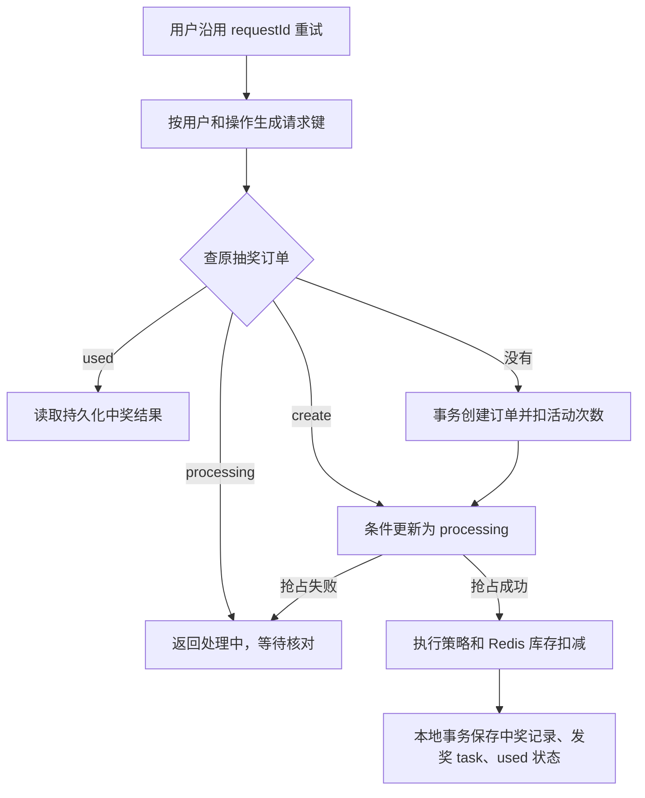
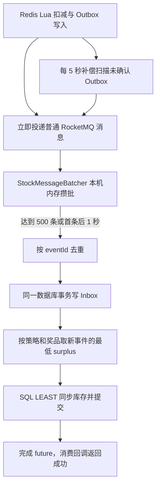

# 项目幂等性说明与加固记录

## 当前实现概览（2026-10-08）

本节以本仓库当前工作区源码为准；后面的 2026-10-01～02 内容保留为历史记录。历史测试数字、外部服务地址及部署状态不代表本轮重新验证的结果。本轮不修改相邻仓库、不重启服务、不迁移真实数据库。

**业务幂等、消息幂等、并发防超卖是三个不同问题。** 同一逻辑请求必须复用请求号；一次业务产生的事件重发必须复用事件号；Redis 锁只负责协调并发，持久化订单/流水和唯一约束才是跨重启的业务依据。消息发送成功也不代表奖品已到账。

### 一、按业务定位幂等保护

| 业务 | 幂等标识 | 防重依据与原子边界 | 重试结果与限制 |
| --- | --- | --- | --- |
| 活动抽奖 | 用户 + 操作 draw + requestId 的 SHA-256 | 抽奖订单 `(user_id, request_id)` 唯一约束；`create → processing` 条件更新抢占策略执行；中奖记录、发奖 task、订单完成在本地事务内 | used 读取原奖品；processing 返回处理中，不重新扣奖品库存；旧客户端不传 requestId 不保证响应丢失后的结果重放 |
| 积分兑换 | 用户 + 操作 exchange + requestId 对应的业务号 | 复用活动额度订单、积分流水；同业务号不同 SKU 拒绝 | 重试继续原业务，不把另一个未支付订单当成当前请求 |
| 活动 SKU 预占 | 用户 + outBusinessNo 的预占标识 | Lua 内查询已有预占，再检查和扣库存、保存 SKU 对应关系 | 售罄后原请求仍能找到预占；Redis 与后续 MySQL 建单不在同一事务 |
| 活动次数入账 | 额度订单 outBusinessNo / orderId | 条件改变订单状态，与总/日/月额度变更同一事务 | 已完成订单不重复增加次数 |
| 行为返利/签到 | 用户 + 行为类型 + 奖励类型 + 外部业务号 | SHA-256 业务键、唯一订单、业务订单与 task 同事务 | 重试查原订单；下游继续用该业务号去重，不使用“日期”作为全局唯一号 |
| 积分增减 | 用户与外部业务号、原交易载荷 | 唯一积分流水 + 条件余额更新 + task 同一事务 | 同参数复用原流水，冲突参数拒绝；账户余额不能因并发扣款变负 |
| 积分奖品 | 用户 + 抽奖 orderId | 中奖状态条件更新与积分到账同一事务 | 已完成且载荷相符才算重复成功，找不到原记录不能吞掉异常 |
| 外部额度/余额奖品 | 用户 + 抽奖 orderId 透传为 requestId | 本地检查中奖记录；远端必须以该请求号持久化去重 | 远端成功、本地确认失败后仍可能再次调用远端，依赖接收端幂等契约 |
| 奖品库存消息 | Redis Outbox 中稳定的 `strategyId:awardId:uuid:surplus` | MySQL stock inbox 唯一 event_id；去重记录与库存快照更新同事务 | 同 ID 同载荷跳过，不同载荷拒绝；同批按奖品取最低余量 |
| MQ 补发 | task.messageId 或 Redis Outbox 成员 | 原消息重发，消费者使用业务流水/Inbox 防重 | Broker 确认前不删除待发送依据；消费者提交前不返回消费成功 |

代码入口：

- 请求标识：[RequestIdempotency.java](../big-market-trigger/src/main/java/com/pro/trigger/idempotency/RequestIdempotency.java)、[RaffleActivityController.java](../big-market-trigger/src/main/java/com/pro/trigger/http/RaffleActivityController.java)。
- 抽奖状态：[AbstractRaffleActivityPartake.java](../big-market-domain/src/main/java/com/pro/domain/activity/service/partake/AbstractRaffleActivityPartake.java)、[user_raffle_order_mapper.xml](../big-market-app/src/main/resources/mybatis/mapper/mysql/user_raffle_order_mapper.xml)。
- 活动预占：[activity_stock_reserve.lua](../big-market-app/src/main/resources/lua/activity_stock_reserve.lua)、[ActivityRepository.java](../big-market-infrastructure/src/main/java/com/pro/infrastructure/adapter/repository/ActivityRepository.java)。
- 积分、返利、发奖：[CreditRepository.java](../big-market-infrastructure/src/main/java/com/pro/infrastructure/adapter/repository/CreditRepository.java)、[BehaviorRebateService.java](../big-market-domain/src/main/java/com/pro/domain/rebate/service/BehaviorRebateService.java)、[AwardRepository.java](../big-market-infrastructure/src/main/java/com/pro/infrastructure/adapter/repository/AwardRepository.java)。

### 二、抽奖重试为什么不会再次执行库存脚本



奖品 Lua 本身没有 drawRequestId 去重。其 UUID 标识一次扣减事件，不能把再次调用脚本变成业务重放。正常入口依靠上述订单状态阻止第二次执行策略；绕过入口直接调用策略服务不享有这层保护。`processing` 不能按超时时间直接改回 `create`，否则第一次可能已成功扣库存。当前这是防重复执行的安全停点，不是自动完成恢复。

### 三、当前库存攒批与消息重投



- 攒批是 [StockMessageBatcher](../big-market-trigger/src/main/java/com/pro/trigger/listener/StockMessageBatcher.java) 的本地计时器，不是 RocketMQ 延迟通知。多个奖品可以进入同一批，之后再分组。
- [RocketMqConfig](../big-market-app/src/main/java/com/pro/config/RocketMqConfig.java) 通过 `batcher.submit(messages).get()` 等待落库，异常返回重试；数量与时间见 [application.yml](../big-market-app/src/main/resources/application.yml)。1 秒是触发条件，不是端到端延迟上限。
- [StrategyRepository](../big-market-infrastructure/src/main/java/com/pro/infrastructure/adapter/repository/StrategyRepository.java) 与 [strategy_award_mapper.xml](../big-market-app/src/main/resources/mybatis/mapper/mysql/strategy_award_mapper.xml) 实现 Inbox 与 `LEAST(award_count_surplus, surplus)`。重复/乱序快照不会增回库存，不是按收到的消息条数再减一次。
- 活动 SKU 是独立链路：[UpdateActivitySkuStockJob](../big-market-trigger/src/main/java/com/pro/trigger/job/UpdateActivitySkuStockJob.java) 每 2 秒读取 Redis 绝对余量同步，成功后清理旧通知。

### 四、故障与运维边界

| 断点 | 当前处理 | 仍需关注 |
| --- | --- | --- |
| 业务事务已提交，响应丢失 | 沿用业务请求号读取原记录 | 客户端不能失败后立即换新请求号 |
| 抽奖 processing 后进程退出 | 不重新执行策略，返回处理中 | 需根据订单、库存事件、中奖记录人工或专门恢复流程核对 |
| MQ 发送成功但 Outbox 状态更新失败 | 原事件重发，下游去重 | 监控重试、死信及长期未处理记录 |
| MySQL 已提交但消费确认丢失 | 原消息重投，唯一 Inbox / 业务流水拦截 | 去重记录保留时间必须覆盖所有允许的重放窗口 |
| Redis 数据回退或丢失 | Lua 原子性本身不能恢复 | 暂停受影响活动并对账，不能用滞后的数据库库存直接恢复发奖 |
| 新库存周期或补货 | 当前 LEAST 快照只适用于单调递减库存 | 需要库存版本/新账户，不能让历史快照覆盖补货 |

数据库唯一索引和 Inbox 表是前提，迁移文件见历史章节第 5 节。本次不会自动把迁移应用到运行中的数据库。外部额度服务的幂等承诺必须由接收端的持久化凭据实现，本仓库传递 requestId 不能代替远端验证。

### 五、本轮修复与验证

本轮已完成的源码修复：

1. **奖品库存 Lua**：在扣减前拒绝负数/溢出 TTL、错误库存/Outbox 类型；库存 key 缺失时直接失败，不再隐式创建 0 库存。纠正“两个正常并发请求得到同一余量”的注释。Java 的 EVALSHA 与 EVAL 回退统一读取同一份 classpath 脚本，避免修复只对预加载路径生效。
2. **活动预占 Lua**：保存业务预占记录失败时显式恢复刚扣的库存；Java 将异常结果抛出，不能误认为售罄或成功。未增加“缓存丢失就从旧数据库余量自动恢复库存”的行为。
3. **抽奖建单竞争**：同 requestId 的并发插入命中唯一约束后，查找并校验已提交的获胜订单；只有确认为同业务才返回原订单。保留 processing 的保守停止策略。
4. **发奖身份与状态**：分发前查询持久化中奖记录，拒绝缺失记录或错误奖品；已完成的相同奖品直接返回。完成状态更新增加 award_id 条件，防止错误消息完成另一种奖品。缺失奖品定义抛出异常，不再静默确认消息。
5. **业务键输入**：积分/返利拒绝缺失或超出表字段长度的业务号，避免空幂等键和截断后的键冲突；积分金额拒绝无法精确保存的小数精度。活动下单先检查交易策略及基础配置，非法输入不能先占库存。
6. **并发日期与异常响应**：抽奖额度的日/月日期生成改用线程安全格式化；空请求返回明确参数错误。随机积分的概率算法保持原样，未为实现幂等改成订单哈希随机。

新增/扩展验证覆盖：抽奖重复建单恢复、错误业务键、发奖身份不匹配和已完成重投、条件更新、Lua 预验证及 fallback、活动预占写入失败后库存恢复。源码修复不需要新增表；原有幂等迁移仍是运行前提。

**仍未承诺的保证**：当前中奖表未单独保存完整 awardConfig，发奖消息的配置随原 task 保存；历史空配置可能读取当前奖品配置。因此这里只对用户、订单、奖品及状态作本地校验，不宣称任意重构消息的同 ID 不同配置均被本地账本识别。外部发奖在本地尚未完成时可能被并发调用，接收端仍必须用原 requestId 去重并校验金额。Redis 资源故障/ACL 等不可预见命令错误不具有数据库式自动回滚保证。

本轮最终验证（2026-10-08）：

| 验证 | 结果 |
| --- | --- |
| Java 17、当前源码复制到独立临时目录、全模块重新编译、19 个定向测试类 | **69 项通过，0 失败，0 错误，0 跳过** |
| 其中真实 Redis 奖品脚本检查 | 6 项：正常扣减、缺失库存、负 TTL、溢出 TTL、错误 Outbox 类型、脚本回退 |
| 活动预占隔离脚本 | 12 个并发同业务请求只扣一次；同键不同 SKU 拒绝；售罄后原请求可重试；非法 TTL 写入失败不扣库存 |
| `git diff --check` | 通过 |

首次工作区回归通过 68 项；后续增量回归发现 IDE 生成的 `Unresolved compilation problems` class 污染及一个依赖注释文本的脆弱测试。删除该无业务意义断言，保留真实 Redis 行为测试，最终在无旧 class 的独立源码副本完成上述 69 项验证。未删除或替换运行容器挂载的 JAR。

可复用的定向命令（使用 Java 17；Redis 地址显式提供后，连接失败会失败而不是跳过）：

```bash
# 先把 JAVA_HOME 指向 Java 17，并在环境设置 STOCK_REDIS_PASSWORD。
# 无 IDE 干扰时可直接在仓库运行；有增量 class 污染时用独立源码副本。
mvn test -Pdev -pl big-market-app -am -DskipTests=false \
  -Dtest=BehaviorRebateMessageTest,CreditTransactionFailureTest,ActivityQuotaIdempotencyTest,ActivityStockSnapshotTest,RewardRetryTest,StrategyStockInboxTest,StrategyAwardStockDeductCustomerTest,AwardIdempotencyTest,RequestIdempotencyTest,DrawIdempotencyControllerTest,RocketMqMigrationTest,StockMessageBatcherTest,RaffleActivityPartakeIdempotencyTest,RaffleActivityRequestValidationTest,StockDeductionScriptTest,StockDeductionRedisTest,CreditAdjustServiceValidationTest,AwardServiceValidationTest,OpenAIBalanceAwardTest \
  -Dsurefire.failIfNoSpecifiedTests=false \
  -Dstock.redis.address=redis://127.0.0.1:16379

# 设置 REDIS_PASSWORD 后运行；只使用并清理随机隔离测试键。
node docs/dev-ops/test-activity-reservation.cjs
```

本轮没有运行真实 MySQL 事务集成测试、真实 MQ Broker 故障注入或外部额度服务联调；相应数据库事务/消费回调回归使用测试替身，不能替代生产故障验证。未重启服务、未执行 schema 迁移、未提交或推送代码。

---

# 历史加固记录（2026-10-01～02，原文保留）

日期：2026-10-01 至 2026-10-02。范围：`big-market` 的签到返利、积分兑换、活动库存、抽奖、发奖及其对接的 `chatgpt-data` 额度发放链路。采用 MVP 规模的业务修补，不引入分布式事务框架。

## 1. 设计原则

幂等不是“请求只能执行一次”，而是同一业务意图重复执行后，业务结果与执行一次一致。MQ 发送成功、数据库提交成功、HTTP 返回成功之间都存在断点，不能以 Redis 锁或一次成功响应代替持久化业务凭据。

本次采用以下经典做法，不引入分布式事务框架：

1. **业务幂等键**：区分用户、操作类型和请求标识；重试沿用同一个标识，新业务使用新标识。同一个键搭配不同参数必须拒绝。
2. **本地事务与唯一约束**：流水、余额变更、待发送消息一起提交；只有确认是同一业务的重复请求才能返回成功。
3. **Transactional Outbox**：继续使用现有 `task` 表保存待发消息。事务提交后发送，失败由任务重发；重发不代表重新创建业务。
4. **Idempotent Consumer**：接收端依靠业务流水或收件记录去重，不能假定 RocketMQ 不重复投递。
5. **状态条件更新**：类似 `WHERE state = 'wait_pay'` 的更新只有一个执行者成功，后续余额变化与该状态更新位于同一事务。

参考来源：

- [Chris Richardson: Idempotent Consumer](https://microservices.io/patterns/communication-style/idempotent-consumer.html)：将消费标识与业务变更放在同一事务。
- [Chris Richardson: Transactional Outbox](https://microservices.io/patterns/data/transactional-outbox.html)：持久化待发事件，允许可靠重发，接收端仍需去重。
- [AWS Builders' Library: Making retries safe with idempotent APIs](https://aws.amazon.com/builders-library/making-retries-safe-with-idempotent-APIs/)：使用调用方提供的请求标识表达业务意图，检查同键不同参数。

## 2. 已定位的问题与处理

### 2.1 签到和行为返利

原问题：消息把日期直接当作下游唯一业务号，不同用户同一天发生冲突。上一轮已修复这一直接原因；本轮进一步处理：

- 新事件业务键使用 `SHA-256(userId + NUL + behaviorType + NUL + rebateType + NUL + outBusinessNo)`，固定 64 字符，适配下游 `varchar(64)`，避免长支付单号超长，以及不同业务类型串号。
- 重试先查询同一用户、行为、外部业务号的原返利订单，返回原订单编号。
- 保留历史已落库订单的业务号，不批量改写已经发放成功的流水，避免升级后重复发奖。
- 并发插入冲突后必须查到对应业务的原订单，才可以按重复请求处理。
- 返利消费失败、库存不足和未验证的唯一键冲突不再被当成成功消息直接丢弃，应进入重试/死信处理流程。

主要代码：`BehaviorRebateService`、`RebateMessageCustomer`。

### 2.2 积分账本

原问题：扣款传负数，但预检查直接拿余额和负数比较；余额更新没有非负条件。原有锁还按订单加锁，不同订单可以并发修改同一账户。

修复：

- 先按用户和业务号查询原积分流水；金额、交易方向和交易名称一致时返回原订单，不再修改余额或新建消息。
- 同一个业务号传不同金额/方向/用途返回参数错误。
- 账户锁按用户串行化，使用 watchdog 自动续期；数据库仍保留最终并发保护。
- 先插入唯一积分流水，再变更余额和写 `task`，三者在同一事务内。
- SQL 使用 `available_amount + delta >= 0` 与账户状态条件，更新数不为 1 则回滚。
- 不允许给不存在的账户创建负余额；交易方向与金额符号必须匹配。
- 事务异常向上抛出，不能回滚后继续发送“调整成功”事件。
- 正向赠送积分不再触发活动商品发货；负向支付找不到订单时不能悄悄确认成功。

主要代码：`CreditAdjustService`、`CreditRepository`、`user_credit_account_mapper.xml`、`CreditAdjustSuccessCustomer`。

### 2.3 活动 SKU 库存与额度订单

原问题：每次重试在数据库唯一键判断之前就扣 Redis 库存；另外定时任务 `drainTo` 后 SQL 失败，会永久丢掉该批扣减。

修复：

- 按业务号精确查原额度订单，已经存在时直接返回，不再扣库存。不再用“同 SKU 任意未支付订单”替代本次业务。
- Lua 原子执行“检查业务预占记录 + 判断库存 + 扣减 + 保存预占记录”。同一业务预占只扣一次，同键不同 SKU 拒绝。
- 即使库存已经为 0，原业务的重试仍可以识别既有预占；新业务不能继续扣减。
- 预占记录保留到活动结束后 7 天，最低 1 天。长期已完成业务由数据库订单去重，不依赖 Redis 记录永远存在。
- 每 2 秒同步已初始化 Redis 库存的绝对剩余量到 MySQL，SQL 仅允许剩余量减小；相同快照重复执行不再扣减，旧快照也不会把库存加回去。
- SQL 同步成功后才清理旧版延迟队列通知；即使清理失败，下次同步仍安全。
- 未初始化的缓存不会把数据库库存清零；库存初始化使用原子 `trySet`，不会覆盖已经消耗的库存。

主要代码：`AbstractRaffleActivityAccountQuota`、`ActivityRepository`、`activity_stock_reserve.lua`、`UpdateActivitySkuStockJob`。

### 2.4 抽奖和兑换接口

- `ActivityDrawRequestDTO`、`SkuProductShopCartRequestDTO` 增加可选 `requestId`。服务端按用户、操作类型、请求号生成固定长度业务键，不按请求时间生成新单号。
- 同一请求号重复抽奖先查询原订单；已完成时读取原中奖结果，不再次执行策略或扣次数。同键不同活动拒绝。
- 抽奖策略执行前通过数据库条件更新抢占订单：`create -> processing`；中奖记录、发奖 outbox 和 `processing -> used` 在本地事务内提交。
- 若进程在策略扣库存后、结果入库前退出，重试看到 `processing` 返回 `ERR_BIZ_010`，不自动重新抽奖。此时宁可等待对账，也不能再次扣库存。
- 兑换重试复用原额度订单和原积分支付流水；同键不同 SKU 拒绝。
- 前端抽奖、兑换失败后保留请求号，成功后才清除。旧客户端不传请求号仍可调用，但不具备新接口的跨响应丢失重放保证。
- 日期格式化改用线程安全的 `DateTimeFormatter`，避免共享 `SimpleDateFormat` 并发串号。

主要代码：`RequestIdempotency`、`RaffleActivityController`、`AbstractRaffleActivityPartake`、`UserAwardRecordQueryService`、`user_raffle_order_mapper.xml`；前端 `src/app/pages/market/`。

### 2.5 发奖和跨服务额度

- 积分奖品先条件更新中奖记录，只有抢占成功才改余额，两者同一事务。重复消息必须查到已完成且奖品相符的原记录；不能把“记录不存在”当成重复成功。
- 账户写入冲突或条件更新失败会回滚发奖状态并抛出异常，交给 MQ 重试。
- 对话额度发放将抽奖订单号透传为 `requestId`。接收端 `openai.account_quota_grant` 用 `(openid, request_id)` 唯一键保存凭据，账本插入和额度增加由一个真实数据库事务提交。
- 同键同金额返回当前账户结果，不重复加额度；同键不同金额拒绝。限制用户标识、请求号长度及额度正数，避免 `INSERT IGNORE` 对超长输入的隐式截断。
- 远端成功后才完成本地中奖状态；本地更新失败可安全重试远端。缺失本地中奖记录不会被静默确认。

主要代码：`AwardRepository`、`OpenAIAccountAdjustQuotaAward`、`AwardPort`；相邻项目 `chatgpt-data` 的 `AccountRepository` 与 `account_quota_grant_mapper.xml`。

### 2.6 奖品库存消息

原有奖品库存已使用单调递减的绝对快照，并非每次重投都直接再次减库存。本轮在此基础上补充持久化去重和异常校验：

- `strategy_award_stock_inbox` 保存稳定事件号及策略、奖品、剩余量；收件记录和库存快照更新在默认配置库的同一事务内完成。
- 重复事件查询持久化载荷；同事件号不同载荷拒绝。同批内冲突也在写数据库前拒绝。
- 使用普通 `INSERT` 捕获唯一冲突，再 `SELECT ... FOR UPDATE` 校验，避免把 JDBC 的无变化更新行数误当成新增成功。
- 新事件按奖品聚合最小剩余量，旧快照不增加库存；不存在的奖品不能落入 inbox 后被当成成功。
- 保留现有 Redis outbox 与 RocketMQ 批处理接线；生产发送未确认时不能清除 outbox，消费异常返回重试。

主要代码：`StrategyRepository`、`StrategyAwardStockDeductCustomer`、`strategy_award_mapper.xml`。

## 3. 验证方式

### 聚焦单元测试

使用 Java 17。项目内 IDE 的增量编译产物曾混入无效 class，验收使用 `mvn clean` 开始的构建。

```bash
mvn clean test -Pdev -pl big-market-app -am \
  -DskipTests=false \
  -Dtest=BehaviorRebateMessageTest,CreditTransactionFailureTest,ActivityQuotaIdempotencyTest,ActivityStockSnapshotTest,RewardRetryTest,StrategyStockInboxTest,StrategyAwardStockDeductCustomerTest,AwardIdempotencyTest,RequestIdempotencyTest,DrawIdempotencyControllerTest,RocketMqMigrationTest,StockMessageBatcherTest \
  -Dsurefire.failIfNoSpecifiedTests=false
```

覆盖：不同用户同日隔离、不同业务隔离、长业务号、旧签到重试、积分重复入账、参数冲突、余额不足回滚、活动订单重复、库存快照重复执行。

### 真实 MySQL 事务验证

`CreditIdempotencyDatabaseTest` 需要设置 `MYSQL_PASSWORD` 和 `IDEMPOTENCY_JDBC_URL`，然后加入上面的 `-Dtest` 列表。未设置连接变量时会跳过，不能将跳过视为数据库验证通过。

测试创建随机名称的隔离数据库，复制实际账本表结构并加载实际 MyBatis mapper，使用真实事务管理器，结束后删除自身测试库。数据库用户必须有创建和删除测试库权限，只应针对本地测试实例运行。

本次验收：禁用测试中的 Redis 锁后，12 个并发相同积分业务最终只有一笔流水、一条 outbox 和一次余额增加；两个不同业务同时扣款，只有余额足够的一笔提交，余额不为负，失败事务不残留流水。并发冲突允许先失败再用原业务号重试，不承诺所有首次调用都立即成功。

### 本地真实 Redis 并发验证

```bash
# 在环境中设置本地 Redis 密码，不要把真实密码提交到仓库。
node docs/dev-ops/test-activity-reservation.cjs
```

需要 `REDIS_PASSWORD`；可用 `REDIS_CONTAINER` 覆盖默认本地容器名。脚本只使用随机测试前缀，结束后清理自己创建的键。验证 12 个并发重复请求只预占一次、同键不同 SKU 拒绝、售罄后旧请求仍可安全重试。

### 验收结果

| 验证 | 结果 |
| --- | --- |
| big-market 幂等回归，包含真实 MySQL 测试 | 34 项通过，0 失败，0 跳过 |
| RocketMQ 接线及批处理补充回归 | 10 项通过 |
| chatgpt-data 额度账本、对话扣额及流式回归 | 24 项通过 |
| 实际 Redis Lua 预占并发脚本 | 通过 |
| 实际 8093 HTTP 接口并发发奖 | 8 次相同请求仅入账一次；更改金额被拒绝 |
| 前端 `tsc --noEmit --incremental false` | 通过 |
| 本地服务 | 8092、8093 健康检查 UP，3003 返回 HTTP 200 |

HTTP 验证使用随机测试用户，验证一条发奖账本及额度为 3 后，已删除该测试用户的账本与账户，未增加真实用户额度。没有执行全链路 kill -9 故障注入，也没有覆盖所有第三方支付异常。

## 4. 运维和边界

- 本次不自动批量补发历史账户奖励。发现历史失败记录时，应先核对返利订单、积分流水、额度订单和消息状态，再按原业务重放。上一轮的 `dev-ops/mysql/sql/repair-sign-rebate.sql` 只用于已核实的单个用户和分片，不应当成全库通用迁移。
- `task.state = completed` 只证明消息已发送，不证明下游已经入账；对账必须检查业务账本。需要监控 MQ 重试和死信，不能无限保留静默失败。
- Redis 预占与 MySQL 订单不是同一事务。预占后进程退出、永久不再重试，仍可能占住库存；灾难恢复和过期预占释放需要独立对账，不宣称跨 Redis/MySQL/MQ 的严格 exactly-once。
- 活动库存绝对快照适用于当前“库存只减、活动内不在线补货”的模型。补库存必须同时更新数据库、缓存及库存版本；不能只修改 MySQL。
- Lua 使用当前单机 Redis 配置。迁移到 Redis Cluster 时，需要给同一脚本涉及的键设计同槽 hash tag，并一起迁移旧键。
- 不能直接回退到旧的队列计数扣减任务，旧通知与新快照混用会重复扣减。
- MQ 消费去重记录的清理周期必须大于消息重试/重放周期；随意清理业务唯一键会失去幂等保证。
- 前端请求号目前保存在组件内存中，不跨刷新、退出登录或不同浏览器持久化。响应未知时不要通过刷新制造新业务；生产级客户端可按用户和操作持久化待确认请求并提供查询接口。
- `processing` 是持久化的待对账状态，不是可以按超时随意重置的锁。应按用户分片检查订单、中奖记录、发奖任务和 Redis 库存事件；确认没有副作用才可制定补偿。不能盲目改回 `create`，也不能仅凭超时退次数，否则会重新开放重复扣减窗口。
- 对话扣额原有 requestId 账本、一次性返还流程本轮只做回归，没有替换为新设计。支付宝/微信支付链路不在本次新增修复的验收范围内。

## 5. 迁移与部署

先备份并执行增量 DDL，再部署代码。此次本地三组迁移均已执行并核对：

1. `docs/dev-ops/mysql/sql/idempotency-request-id.sql`：两个用户库各四张抽奖订单表，新增可空 `request_id` 及 `(user_id, request_id)` 唯一索引。此脚本仅运行一次；部分执行后须先检查 `information_schema`，不能整段盲目重跑。
2. `docs/dev-ops/mysql/sql/strategy-award-stock-inbox.sql`：默认 `big_market` 库新增库存 inbox。
3. 相邻项目 `chatgpt-data/docs/dev-ops/environment/sql/account_quota_grant.sql`：`openai` 库新增额度发放账本。

部署顺序为 `chatgpt-data` 接收端、`big-market` 调用端、前端。旧的额度发放调用方没有 `requestId` 会被拒绝，其他对接方也须同步升级。本地市场服务的 gateway 已指向 `http://host.docker.internal:8093/`，避免误调用仍在 8091 的旧聊天容器。

本地 Docker 挂载 jar 经 `mvn clean package` 替换后，若 restart 出现旧文件挂载失效，使用 `docker compose -f docs/dev-ops/docker-compose-local.yml up -d --no-deps --force-recreate big-market` 仅重建应用容器，不删除数据卷。

回滚时保留新增字段和账本，不删除已生成幂等凭据；禁止直接退回非幂等额度接口或计数式库存回写。历史未携带请求号的记录不做猜测式补键、不自动补发，单独对账。

## 6. 功能提交

提交沿用各仓库原有 `fix:` / `test:` / `docs:` 格式；chatgpt-data 沿用全角冒号。

| 仓库 | 提交 | 内容 |
| --- | --- | --- |
| big-market | `ec1360e` | 行为返利、积分账本与并发超扣 |
| big-market | `1c98cc6` | 发奖状态与远端幂等键 |
| big-market | `adf2569` | 兑换、库存预占和抽奖状态保护 |
| big-market | `2a31afe` | 库存 inbox，包含其依赖的现有 RocketMQ 接线 |
| big-market | `257a3b4` | 库存事件测试适配 |
| chatgpt-data | `1fb0575` | 接收端额度账本与原子入账 |
| chatgpt-web | `e7be932` | 福利页请求号复用，包含现有福利页布局依赖 |

本说明单独提交。其他原有技术栈、鉴权、支付等未提交改动保留，不将工作区宣称为干净状态，也未推送远程仓库。
