# LLM Market 架构与业务全链路：面试画图和讲解稿

核查日期：2026-10-07。依据当前工作区代码、数据库配置和本地部署整理；不是理想化设计稿。本文中的“额度”分为抽奖次数和人民币对话余额，面试时不要混称。流程图使用 Mermaid，可在支持 Mermaid 的 Markdown 阅读器中直接查看。

## 1. 先用一分钟介绍项目

> 这是一个把营销抽奖和 AI 对话连接起来的应用。营销服务负责签到返利、积分兑换、抽奖和发奖；聊天服务负责登录、充值订单、钱包和模型计费。用户签到获得积分和抽奖机会，抽奖可以获得对话余额，也可以直接充值。模型调用前先预占余额，拿到实际 Token 用量后结算。营销侧通过本地事务消息表和 RocketMQ 做异步发奖与重试，用户订单通过 Canal 同步到 Elasticsearch，供运营后台查询。核心资金和次数账本仍以 MySQL 为准。

“签到 → 抽奖 → 充值 → 对话”是演示顺序，不是强制依赖：有余额就能对话，不必先签到或抽奖。

## 2. 面试白板先画这张整体架构

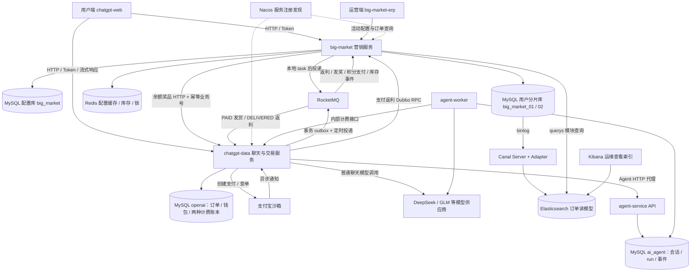

讲解顺序：先画用户端和两个 Java 服务，再画各自数据库，随后补 Redis / MQ，最后画 ES 查询侧和 Agent 扩展。不要一上来堆中间件名称。

| 模块 | 职责 | 不负责什么 |
|---|---|---|
| chatgpt-web | 用户登录、福利页、充值、聊天交互 | 不可信任前端自行决定扣费或中奖结果 |
| big-market | 活动、次数、积分、抽奖策略、奖品发放 | 不直接修改聊天服务的钱包表 |
| chatgpt-data | 用户身份、支付订单、钱包、模型费率、扣费与结算 | 不决定营销奖品概率 |
| big-market-erp | 活动展示、渠道上下架、抽奖订单查询 | 不是数据库管理工具 |
| agent-service / worker | 独立的持久化会话、任务执行、事件与产物 | 钱包计费权仍在 Java 服务 |
| Redis | 热配置、库存控制、分布式锁等 | 不能替代持久化资金账本 |
| RocketMQ | 解耦返利、发奖、发货、库存写回 | 消息送达不等于业务一定成功 |
| Canal + ES | 从 MySQL 订单产生运营查询读模型 | ES 不参与扣钱、扣次数的事务 |

本地主要入口为用户端 3002、运营端 8000、营销服务 8092；容器内外端口和地址由 Compose 决定，不要在面试中把端口当架构重点。这里是同一开发环境的多个容器，不代表已经拥有生产多机容灾能力。

### 营销服务内部的分层

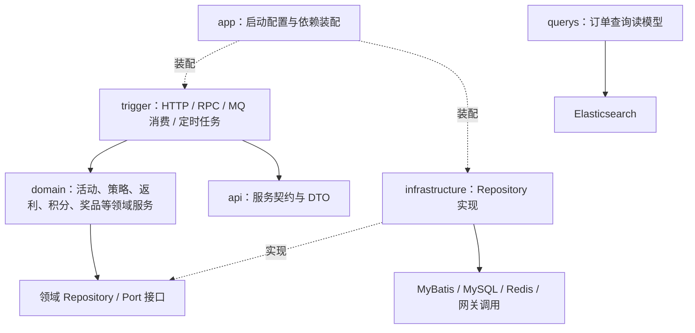

依赖方向与调用方向要分开讲：运行时领域通过 Repository 接口调用基础设施；领域层不需要直接依赖具体 Mapper。当前实现并非绝对纯领域模型，部分领域服务仍使用 Spring 注解，不能说成“完全没有框架依赖”。

## 3. 三种资产，四种订单

| 对象 | 单位 | 主要存储 | 获得 / 消耗 |
|---|---|---|---|
| 积分 | 积分 | user_credit_account、user_credit_order | 签到/积分奖增加；兑换次数商品减少 |
| 抽奖资格 | 次 | raffle_activity_account 及日/月账户 | 签到 SKU / 积分兑换增加；参与抽奖减少 |
| 对话钱包 | 元，8 位小数 | account_wallet、balance_grant；Agent 使用 agent_call_charge / ai_run_budget，旧聊天使用 chat_quota_request | 余额奖品/充值增加；模型实际使用减少 |

订单不要混淆：`user_behavior_rebate_order` 是返利订单，`raffle_activity_order` 是次数商品订单，`user_raffle_order` 是一次抽奖的参与单，聊天服务的支付订单是充值订单。中奖结果另存 `user_award_record`。

配置表也不是用户资产表：

- `raffle_activity`：活动名称、有效期、开放状态、策略。
- `raffle_activity_listing`：channel + source 对应的活动及上下架状态。
- `raffle_quota_plan`：每份套餐增加的总/日/月次数；业务编号 `quota_plan_id`。
- `raffle_quota_product`：活动 + 次数套餐 + 积分价格 + 商品库存。
- `strategy` / `strategy_award` / `award`：策略、奖池、概率、奖品类型和发放配置。

总/日/月次数是同时生效的约束，5/5/5 不代表 15 次；它们也不是 AI 对话额度。

## 4. 一眼看懂完整业务循环

按三条纵向流程阅读：签到和抽奖、充值、对话计费。前两条路径汇入同一个对话钱包；积分奖与支付返利回到营销链路。**有余额即可对话，不必先签到或抽奖。**

### 4.1 签到与抽奖：获得积分、次数和余额


[查看 Mermaid 源码](../figures/business-cycle-raffle.mmd)

### 4.2 充值：钱包入账，并触发营销返利


[查看 Mermaid 源码](../figures/business-cycle-payment.mmd)

### 4.3 对话：预占余额，按实际用量结算


[查看 Mermaid 源码](../figures/business-cycle-chat.mmd)


当前本地签到配置是 10 积分 + SKU 9901；9901 对应 1 次套餐。支付行为也有返利配置，规则来自 `daily_behavior_rebate`，不是前端写死。金额、概率和赠送规则都是当前配置快照，不能当永久业务承诺。

## 5. 签到：先落返利事实，再异步发资产

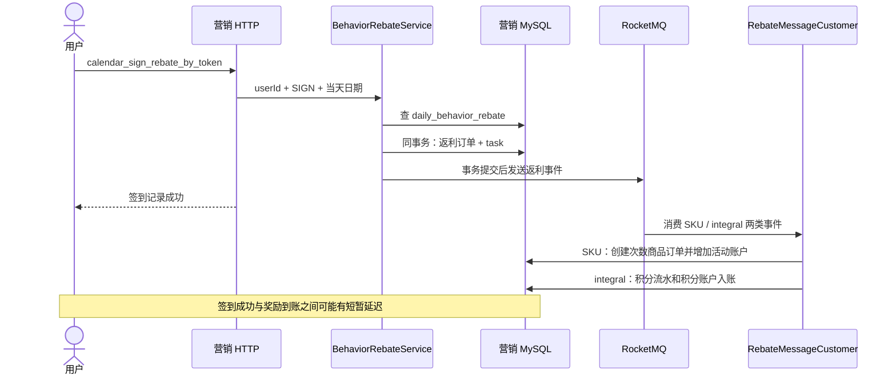

幂等：以用户、行为、奖励类型和日期形成稳定业务号，重复签到复用原业务，不因重试再次发放。消费端还要用原业务号保护入账。`task` 与返利订单同事务保存，发送失败由任务补发；task 的 completed 仅表示发送完成。

### 5.1 消费者幂等：同一奖励投递多次，资产只增加一次

这里说的是 `send_rebate` 的 `RebateMessageCustomer`，不是充值 `payment_lifecycle` 的消费者。签到一次会产生积分和次数商品两种奖励，各有自己的业务号、各自完成入账；两种奖励不在同一个消费事务中，因此可能先后到账。

#### task 到底插几条，topic 分别是什么？

按当前“签到送 10 积分 + SKU 9901 的 1 次抽奖机会”配置，一次首次成功签到，**签到事务插入 2 条 task；后续积分入账事务再插入 1 条，整个链路累计产生 3 条**。这个数量来自当前奖励配置，不是所有签到场景固定写死为 3 条。

`task` 是待投递消息的持久化记录，保存 topic、messageId、消息内容和发送状态。**Topic 是消息主题**，用于组织消息、供对应消费者订阅；同一个 topic 可以承载多条不同业务消息。这里两条返利消息共用 `send_rebate`，消费者通过消息体的 `rebateType` 区分奖励。

| 记录 | 在哪个事务中创建 | topic | 消息内容及用途 |
|---|---|---|---|
| task① | 签到返利事务，与两条返利订单一起提交 | `send_rebate` | `rebateType=integral`、`rebateConfig=10`，请求增加 10 积分 |
| task② | 同一个签到返利事务 | `send_rebate` | `rebateType=sku`、`rebateConfig=9901`，请求发放该商品对应的抽奖次数 |
| task③ | 消费 task① 后的积分入账事务，与积分流水和账户增加一起提交 | `credit_adjust_success` | 金额为 `+10`，表示积分已经调整成功 |

①②③是讲解编号，不是数据库自增 ID 或保证的执行顺序。每条消息有自己的 messageId；①②还有不同奖励类型对应的 bizId。消息补发复用原 task，重复业务消费复用原订单，不会每次重试都新增这三条记录。

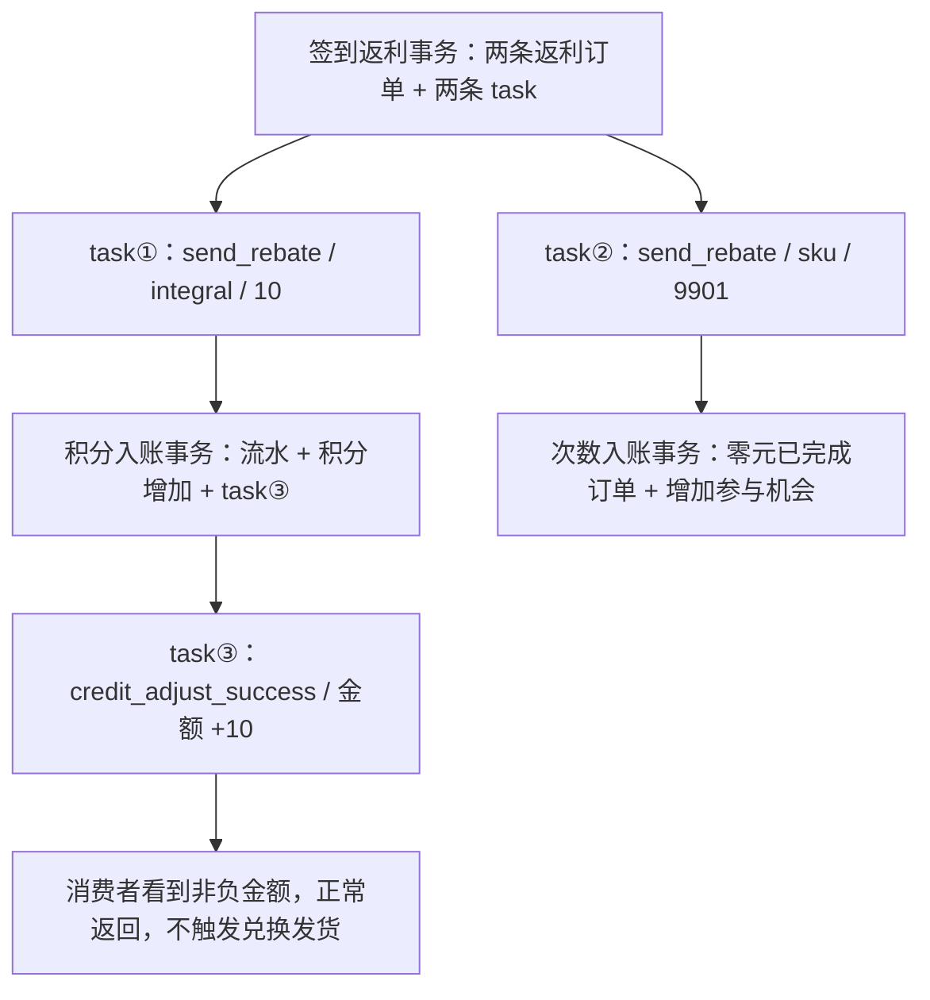

#### 第三条消息和积分兑换是什么关系？

`credit_adjust_success` 是通用的“积分调整成功”事件，当前积分交易服务在加积分和扣积分时都会产生它。它主要用于衔接积分兑换的后续发货，但**签到出现这条事件不代表用户进行了兑换**，也不是要再次增加积分。

| 场景 | 事件产生前已经完成什么 | 事件金额 | `CreditAdjustSuccessCustomer` 的处理 |
|---|---|---|---|
| 签到送积分 | 积分流水、账户增加和 task③ 已在一个事务中提交 | `+10` | 发现 `amount >= 0`，直接成功返回；不发放兑换商品 |
| 积分兑换抽奖次数 | 先创建待支付次数商品订单，再事务提交积分流水、扣积分和消息 task | 例如 `-5` | 通过用户和 `outBusinessNo` 定位兑换订单，执行幂等发货，完成订单并增加抽奖次数 |

兑换时，次数商品订单和负向积分流水使用同一个外部业务号，所以扣积分成功事件能够关联到待发货订单。签到的积分奖励则使用返利 bizId，不存在对应的积分支付待发货订单，因此消费者必须区分正负金额。

当前实现会为签到正向积分生成一条随后被消费者忽略的事件，这是复用通用积分变更流程的结果。可以理解为“记录并广播积分已经变化”，不能把它描述成“签到又执行了一次兑换”。源码见 [积分事件构建](../big-market-domain/src/main/java/com/pro/domain/credit/service/CreditAdjustService.java)、[积分变更消费与金额判断](../big-market-trigger/src/main/java/com/pro/trigger/listener/CreditAdjustSuccessCustomer.java) 和 [topic 配置](../big-market-app/src/main/resources/application.yml)。

**第一步：把稳定的业务号一直传到资产流水。** `BehaviorRebateService.getRebateMessage` 计算：

```text
bizId = SHA-256(userId + "\0" + behaviorType + "\0" + rebateType + "\0" + outBusinessNo)
```

签到的上游 `outBusinessNo` 是服务端当天日期。例如同一用户同一天的 `sign + integral` 总是得到同一个 `bizId`，`sign + sku` 则是另一个业务号。消费端不会重新生成幂等号，而是把消息中的 `bizId` 原样赋给下游订单的 `outBusinessNo`。

```text
签到日期（上游 outBusinessNo）
  → 用户 + sign + 奖励类型 + 日期 → bizId
  → MQ 消息 data.bizId
  → 积分订单 / 次数商品订单的 out_business_no
```

注意上下游字段虽然都叫 `outBusinessNo`，内容不同：返利订单保存原始日期，资产订单保存上述哈希业务号。MQ 的消息 ID、消费次数和新生成的订单 ID 都不作为这次奖励的幂等依据；重新发送消息时必须保留原 `bizId`。

**第二步：不同奖励走不同入账事务。**

| 消费分支 | `integral`：签到送 10 积分 | `sku`：签到送 SKU 9901 的 1 次参与机会 |
|---|---|---|
| 消费入口 | 构造 `TradeEntity`，正向返利交易 | 构造 `SkuRechargeEntity`，选择 `rebate_no_pay_trade` |
| 业务键传递 | `outBusinessNo = bizId` | `outBusinessNo = bizId` |
| 重复查询 | 按 `userId + outBusinessNo` 查积分订单 | 按 `userId + outBusinessNo` 查次数商品订单 |
| 已存在如何处理 | 校验交易类型、交易名称和金额一致，复用原订单号并返回 | 校验 SKU 一致，返回原订单；先查旧订单，不再重复预占库存 |
| 首次处理事务 | 插入积分订单 → 创建或增加积分账户 → 插入后续积分变更事件 `task` | 插入已完成的零元次数商品订单 → 增加总次数账户及已存在的日/月账户 |
| 持久化防重 | `user_credit_order_000…003.out_business_no` 唯一索引 | `raffle_activity_order_000…003.out_business_no` 唯一索引 |

已核对本地两个用户分片库：这两类订单表均有 `uq_out_business_no(out_business_no)`。实际索引是单字段唯一，不要在面试中说成 `(user_id, out_business_no)` 联合唯一；业务号本身已包含用户，查询和分片路由也使用同一个 `userId`。

**积分分支具体执行顺序：** `CreditRepository.saveUserCreditTradeOrder` 获取用户积分账户锁，设置用户分片路由后查旧流水。存在且金额等字段匹配时直接成功返回，不再加积分。不存在时，在同一个 MySQL 事务中先插入唯一积分流水，再修改账户并保存 `task`。如果插流水、更新账户或保存任务失败，整个事务回滚。并发插入遇到唯一键冲突也回滚并抛错，不直接吞掉；下次消费会重新查到已提交的同业务流水，核对后正常返回。

**次数分支具体执行顺序：** `AbstractRaffleActivityAccountQuota.createOrder` 先查旧订单并核对 SKU；首次执行才检查活动、预占商品库存，再由 `RebateNoPayTradePolicy` 将订单设为 `completed`、金额设为 0，调用 `ActivityRepository.doSaveNoPayOrder`。仓储在用户锁和用户分片路由下，把“插入唯一订单 + 次数增加”放入同一事务。如果两个消费者都在事务前查到不存在，后来的插入由唯一索引拦住、事务回滚；服务只在捕获 `INDEX_DUP` 后重新查到匹配 SKU 的原订单时返回成功。查不到、SKU 不一致或其他异常仍抛出。

总/日/月额度不是三份可相加的机会。日/月账户已存在时会同步增加；尚未创建时，后续参与抽奖再依据主账户初始化。

**第三步：资产事务成功后才确认消息。**

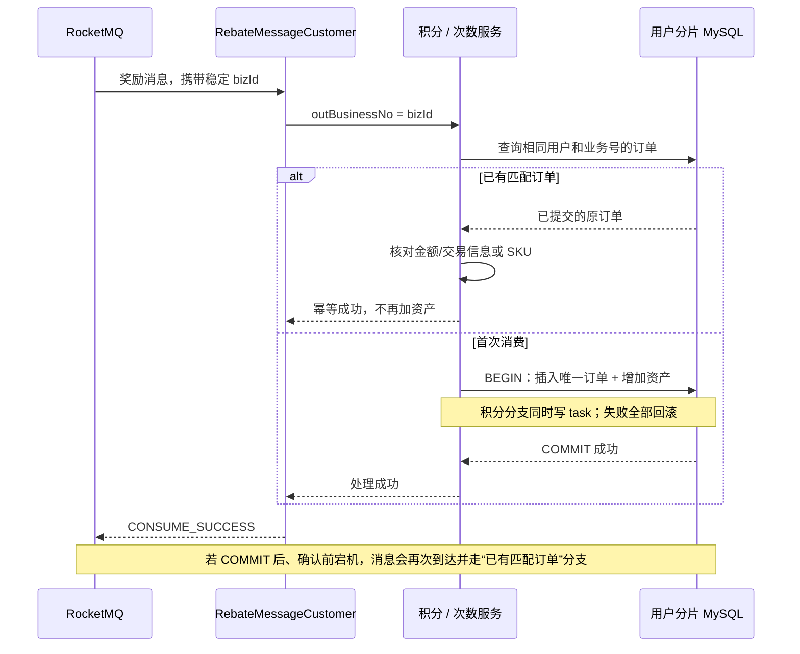

`RebateMessageCustomer` 不会把业务异常当作成功吞掉；外层 `RocketMqConfig.consumer` 在处理正常返回时返回 `CONSUME_SUCCESS`，遇到异常返回 `RECONSUME_LATER`。因此“已经处理过且内容匹配”是成功，“实际入账失败”是重试，“同业务号换了金额或 SKU”也是异常，不能直接跳过当成功。

| 故障发生位置 | 重试后的行为 |
|---|---|
| 事务提交前失败 | 订单和资产一起回滚；重试可重新入账 |
| 事务已提交，消息确认前宕机 | 查到原订单并校验后直接成功；资产不再次增加 |
| 两个消费者并发处理同一奖励 | 锁减少竞争，唯一索引兜底；失败一方回滚后查旧单或等待下一次重试 |
| 积分已入账，但后续积分变更消息发送失败 | 原 `task` 已随入账提交，由任务补发；再次消费签到返利不重新加积分 |
| 同一 bizId 携带不同金额 / SKU | 校验失败，保留异常供排查；不能用“幂等”掩盖载荷冲突 |

**Redis 库存的边界单独讲。** 次数商品在数据库事务前还会预占 Redis 库存，使用 `SHA-256(userId + "\0" + outBusinessNo)` 作为预占号，Lua 将“检查预占记录、扣库存、保存预占记录”原子执行。在预占记录有效期内，相同业务重试不重复扣库存，换 SKU 则拒绝。但 Redis 预占和 MySQL 入账不是同一个事务；预占记录丢失/过期、预占后数据库失败仍需要恢复和对账，不能把数据库的入账幂等说成跨 Redis/MySQL 的原子事务。

这里没有额外的通用 `consumed_message` 表，积分订单和次数商品订单本身就是持久化幂等凭据。锁负责减少并发冲突，唯一索引负责最后防重，本地事务保证“凭据与资产同时成功或失败”。也不能先单独写 Redis `SETNX` 消费标记再加资产：若标记成功后宕机，重试被跳过，就会漏发。

面试可以这样概括：**我允许 MQ 重复投递，但用稳定业务号贯穿消息和资产订单，把唯一流水与资产变更放在同一数据库事务里。重复消费查旧流水并校验后返回成功，真正失败则回滚重试，实现业务效果只发生一次。**

源码定位：[返利业务号生成](../big-market-domain/src/main/java/com/pro/domain/rebate/service/BehaviorRebateService.java)、[返利消费者](../big-market-trigger/src/main/java/com/pro/trigger/listener/RebateMessageCustomer.java)、[积分入账事务](../big-market-infrastructure/src/main/java/com/pro/infrastructure/adapter/repository/CreditRepository.java)、[次数订单防重入口](../big-market-domain/src/main/java/com/pro/domain/activity/service/quota/AbstractRaffleActivityAccountQuota.java)、[次数入账事务](../big-market-infrastructure/src/main/java/com/pro/infrastructure/adapter/repository/ActivityRepository.java)、[MQ 消费确认](../big-market-app/src/main/java/com/pro/config/RocketMqConfig.java)。


## 6. 积分兑换：购买的是抽奖次数

1. 用户选择 SKU，客户端携带可复用 requestId。
2. 服务读取 `raffle_quota_product` 与 `raffle_quota_plan`，校验活动有效、商品库存足够。次数商品的 Redis 库存预占与业务号绑定，防止重试重复占库存。
3. 创建 `wait_pay` 次数订单，再以同一外部业务号创建负向积分交易。
4. 积分流水、条件扣积分和积分调整消息任务在事务内完成；不能先查余额、再无条件更新。
5. `CreditAdjustSuccessCustomer` 只处理负向积分消息，完成次数订单发货，将套餐次数累加到活动账户。正向签到/奖品积分不会误触发发货。

这里的“支付”是积分支付，不经过支付宝，也不增加对话钱包。

## 7. 抽奖：资格事务、策略计算与发奖分开

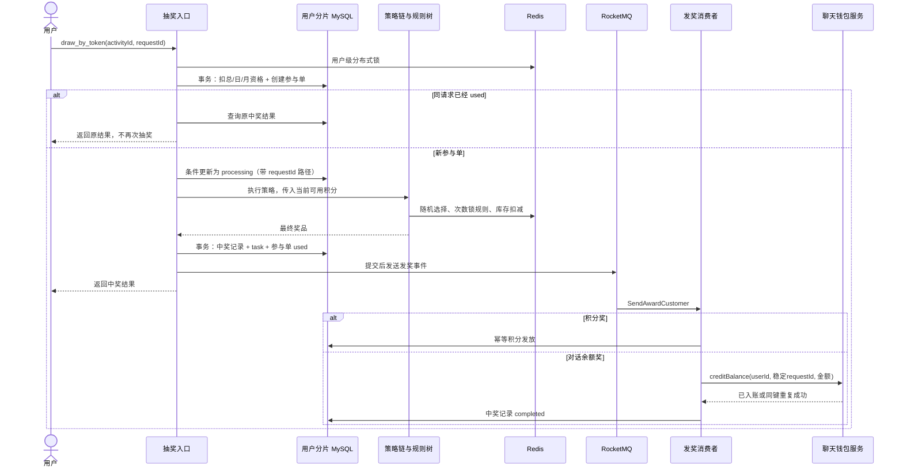

需要补充的准确性边界：

- 参与资格扣减与创建参与单是一个本地事务；整个抽奖流程并非一个跨 MySQL、Redis、MQ 的大事务。
- 活动 100401 的策略 10008 已启用 `rule_weight` 本地演示配置，详见下面的奖池说明。按当前可用积分选择连续区间奖池；具体概率由该区间的奖品权重决定。
- 权重分支选出的只是候选奖品，仍进入规则树检查解锁、库存和兜底；已修正原先权重命中就提前返回的问题。
- `processing` 表示可能已经发生库存副作用，响应异常后不能直接重新抽奖；目前需要对账处理，不要宣称已有全自动补偿。
- 奖品库存 Redis 扣减后通过事件/任务回写 MySQL，使用稳定事件号和库存快照防重。库存与资金账本的处理方式不同。
- 余额奖使用 `raffle:userId:orderId` 作为稳定发放请求号。远端入账成功后才标记本地完成，重投不会重复增加钱包。
- 旧次数奖兼容代码仍存在，但当前余额奖调用 `OpenAIBalanceAward`，不是历史按次数发奖路径。

### 7.1 积分权重：按连续区间选择奖池

本地当前配置（2026-10-07）：活动 100401 使用策略 10008，`rule_models=rule_weight`，`strategy_rule.rule_value` 为：

```text
[0,20):101,1110,1111,1112,1113,1114,1115,1116 [20,100):1110,1111,1112,1113,1114,1115,1116 [100,+∞):1111,1112,1113,1114,1115,1116
```

每组冒号前直接写出**左闭右开区间**，冒号后为奖品 ID 列表。`[0,20)` 包含 0、不包含 20；`[100,+∞)` 表示 100 及以上。代码按区间包含关系匹配，配置顺序不影响结果。20 分属于第二档，100 分属于第三档，21 分、101 分不会掉回默认池。旧的 `20:奖品ID 100:奖品ID` 门槛格式仍兼容，但同一条配置不能混用两种格式。

| 当前可用积分 | 初选奖池 | 子奖池内初选概率 |
|---|---|---|
| `0 ≤ 积分 < 20` | 完整 8 种奖品，包括随机积分和带次数解锁的余额奖 | 与原完整奖池相同 |
| `20 ≤ 积分 < 100` | 全部 7 种余额奖：¥0.10、¥0.50、¥1、¥1.50、¥2、¥2.50、¥5 | 仅排除随机积分；各奖原始权重除以 0.9 |
| `积分 ≥ 100` | 全部 6 种较高余额奖：¥0.50、¥1、¥1.50、¥2、¥2.50、¥5 | 再排除 ¥0.10；按本列顺序为 80%、10%、5%、4%、0.8%、0.2% |

控制器使用**当前可用积分**，不是累计获取积分或累计消费积分；现有接口取整数值传入，对非负积分及整数门槛而言，19.9 仍在第一档，99.9 仍在第二档。规则链收到 null 时按 0 处理。其他策略若未配置 0 档，低于最小门槛时走默认奖池。

这里仅凭积分选择奖池，不扣积分。点击抽奖仍消耗活动参与次数；兑换商品扣积分后，下次抽奖可能回到较低档。页面九宫格仍展示完整活动奖品，不会自动改成子奖池布局。**初选不等于最终发奖**：所有权重候选奖品仍进入规则树，执行次数解锁、库存检查与兜底。

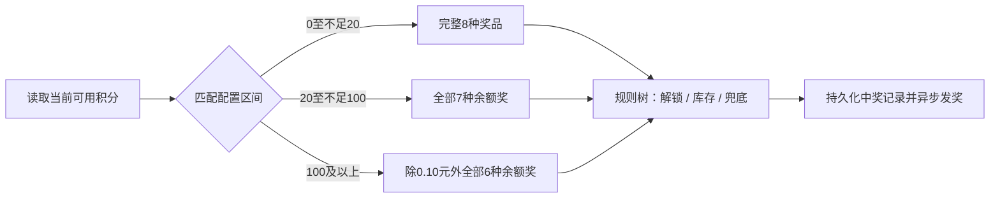

`strategy_rule` 字段含义：`rule_type=1` 表示策略级规则，因此 `award_id=NULL` 正常；`rule_value` 的语法由 `rule_model` 决定。权重规则 `60:102,103,104,105 200:106,107 1000:105` 现在表示 `[60,200)`、`[200,1000)`、`[1000,+∞)` 三档；不是扣积分或百分比。黑名单 `101:user001,user002,user003` 的含义保持不变：这些用户命中后返回奖品 101。

本次修改作用于通用权重代码，因此旧策略 100001、100006 也使用门槛语义，数据库描述已同步。100006 对应测试活动 100301；100001 的奖品仍包含历史对话次数/模型权限，不是当前活动的余额奖品。各策略的奖品 ID 不互相混用。

区间升级只剔除低档奖品，不会移除 ¥2、¥2.50、¥5 等高金额奖品。它们进入候选池后仍需通过原有次数解锁与库存检查；积分档位不会提前解锁奖品。概率是初选概率，兜底处理后的最终结果可能不同。

验证：显式区间相关 11 项测试通过，覆盖边界、空档、最大整数、null、旧门槛兼容、非法配置、装配映射和规则查询映射；已部署并重新装配三档概率表，装配和权重查询接口均返回成功。奖品补全后，再次核对三档缓存分别包含 8 / 7 / 6 种奖品、10000 / 9000 / 1000 个概率位置，均保留 1113、1114、1115 三个高额奖品。装配前后 8 种奖品实时库存未变化，未修改用户积分或消耗抽奖次数。

部署配置先执行 [区间规则迁移 SQL](dev-ops/mysql/migrations/20261007_strategy_weight_intervals.sql)，再执行 [完整奖品修正 SQL](dev-ops/mysql/migrations/20261007_strategy_weight_prize_completion.sql)，后者补齐中高档高金额奖品；最后执行 [显式区间配置 SQL](dev-ops/mysql/migrations/20261007_strategy_weight_readable_intervals.sql)，把当前策略的存储格式改成可直接阅读的区间，奖品集合与概率不变。数据库与新版代码需配套部署，刷新策略缓存、清除进程内责任链缓存，并重新装配概率表；禁止清空实时库存来刷新规则。

## 8. 充值和对话计费

### 8.1 充值：支付状态与钱包到账是两件事

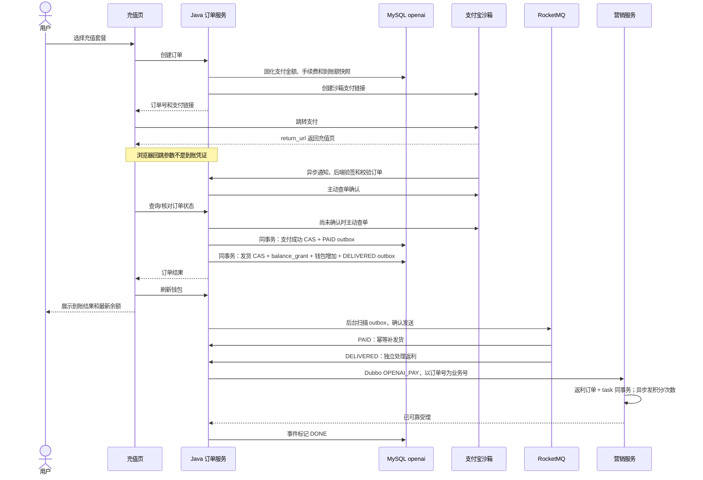

金额必须由后端套餐配置计算，并保存订单快照；重复回调不得按最新套餐重新算钱。当前充值规则：支付金额不超过 50 元收取 20%，超过 50 元收取 10%，对本次全额计算。例如 9.90 元支付、1.98 元手续费、7.92 元到账。抽奖余额奖励不经过充值手续费逻辑。

`OrderRepository.deliverGoods` 用订单状态 CAS、`balance_grant` 唯一业务号和钱包入账构成同一个数据库事务。支付来源使用 appId=payment、requestId=orderId。重复发货不重复加钱，缺失到账快照的历史订单不能猜金额自动发货。

**充值可靠事件：** `payment_event_outbox` 与业务事务绑定。确认支付时写 PAID；钱包入账时写 DELIVERED。发送器扫描事件并同步发送至 `payment_lifecycle`，收到 broker 确认才记录 SENT；消费者按数据库事件和订单校验、处理，完成后记录 DONE。同步发货保留用于缩短到账等待，PAID 消费提供故障恢复，二者使用同一幂等发货事务。

返利只由 DELIVERED 消费触发。钱包入账成功但营销 RPC 失败时，重试的是返利，不会重复加钱包余额。营销服务按用户、行为、订单号形成稳定返利业务号，其返回成功表示返利已可靠受理，积分/次数仍由营销 MQ 消费完成。事件 DONE 不表示所有下游资产已经到账。

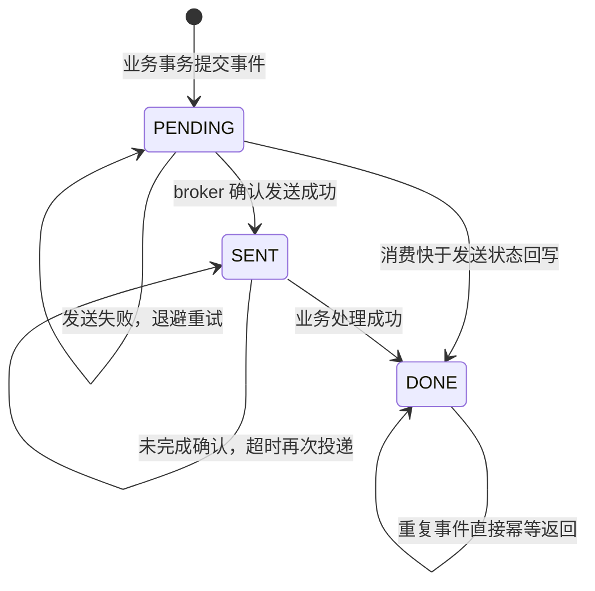

这是“至少一次投递 + 业务幂等”，不是消息恰好投递一次。发送成功但更新状态前崩溃、消费成功但确认前崩溃，都允许重复投递。数据库保留尚未 DONE 的事件用于恢复；异常需要结合事件状态、重试次数、MQ 死信和营销 task 排查。新增表不自动回填历史已完成订单，避免未经核对就给历史充值补奖励。


### 8.2 当前主聊天路径：Agent run 可以包含多次模型调用

当前前端对话组件使用 `agent-chat-store`。普通聊天接口仍保留，但不能把它当作当前页面的唯一调用链。

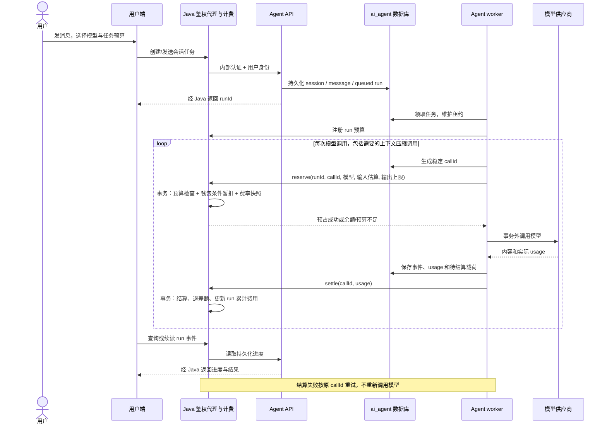

Java `AgentBillingService` 是扣费权威，Python 不能直接写钱包。`ai_run_budget` 记录任务预算与累计费用，`agent_call_charge` 记录每次模型调用的预占、费率、usage 和结算。Python 的任务/消息/模型调用记录属于执行事实，Java 的钱包及计费表属于资金事实，两者用途不同。

**当前 Agent 结算采用授权封顶：** 假设预占 H，实际 usage 计算成本 C，则用户本次结算 `min(C, H)`；C 小于 H 时退差额，C 超过 H 时不追加扣钱，而是记录实际成本、超出部分和 review 标记。预算或余额不足时不开始对应模型调用。

无可靠 usage 时释放预占；已取得可靠 usage 后再取消仍需要结算。Python 保存待结算载荷并由 reconciliation 重试，Java 对过期租约执行恢复处理；不把“重新生成答案”当成结算重试。未知用量可能造成上游成本由系统承担，这是当前选择的成本边界。

### 8.3 保留的普通聊天接口：不能与 Agent 账本混讲

普通 SSE 聊天走 `ChatGPTAIServiceController → USER_QUOTA → provider → ChatStreamListener`，使用 `chat_quota_request` 保存请求账本，预占金额在 `charge_amount` 中。当前所有新请求走钱包，没有新用户免费次数兜底。

这条旧接口的结算策略与 Agent 不同：C 小于 H 退差额；C 大于 H 尝试补扣，余额不足则保留原预占并进入 REVIEW。无 usage 的失败释放预占，恢复任务只处理过期 RESERVED。不要将 Agent 的封顶规则说成这个接口的规则，也不要把两个账本当成每次对话都会同时扣一次。

### 8.4 按什么金额扣费？

```text
费用 = 向上取整到 8 位小数 (
  [未命中输入Token × 输入单价
   + 缓存命中输入Token × 缓存输入单价
   + 输出Token × 输出单价] / 1,000,000
)
```

单价单位为元/百万 Token。最终使用供应商 usage，模型费率按调用保存快照；输入估算只用于预占。金额使用 BigDecimal 和 DECIMAL，避免浮点误差。

举一个纯计算示例（不是线上费率）：输入 1000 Token、其中命中 200，输出 500；价格分别为 2、0.5、8 元/百万 Token，则费用为 `(800×2 + 200×0.5 + 500×8)/1000000 = 0.00570000 元`。输入包含真正发送的历史上下文，不只是本轮用户那句话。Agent 一次任务可能多次调用模型，所以一次点击不等于只产生一笔模型费用。

## 9. ES 在链路中是什么位置

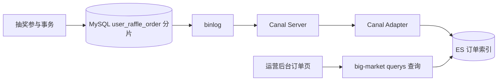

这是读写分离的读模型。用户库按 userId 路由，设计为 2 库 × 4 个订单表分片；配置库不按用户分片。订单页有延迟时，依次核对 MySQL 订单、binlog/Canal、Adapter、ES 文档和查询条件。ES 没查到不能推断抽奖没成功，更不能据此退款或重新发奖。

## 10. 面试官追问时的回答重点

| 追问 | 可以据实回答 |
|---|---|
| 为什么用 MQ？ | 将签到响应与奖励发放、中奖响应与钱包入账解耦，失败可重试；代价是短暂最终一致和补偿运维成本。 |
| 如何防止重复发奖？ | 稳定业务号 + 唯一约束 + 事务/CAS；分布式锁只是降低并发，不能独自承担持久化幂等。 |
| MQ 发失败怎么办？ | 业务记录与 task 同事务提交，提交后发送，失败由任务重试；消费者另做幂等。 |
| Redis 扣了但 DB 没写怎么办？ | 不是原子跨资源事务；用预占业务号、processing、库存事件与对账限制重复副作用，仍有故障恢复边界。 |
| 用户重复点击怎么办？ | 同一次业务复用 requestId。新 requestId 是新业务；旧客户端不传 requestId 时不能承诺同样的重放保证。 |
| ES 故障影响扣款吗？ | ES 不在交易事务内；影响运营查询，不应用 ES 结果决定扣款和发奖。 |
| 上架与活动开启有何区别？ | listing 控制渠道入口映射；activity.state 和有效期控制活动本身可参与性。 |
| 这是生产成熟系统吗？ | 当前是本地可演示工程，需要继续补监控告警、死信处理、自动对账、故障演练与容量评估，不能声称无限扩展或零丢失。 |

## 11. 建议的面试演示顺序

1. 画整体架构，说明营销和聊天服务的资产边界。
2. 展示签到前后积分和抽奖次数变化，解释异步到账。
3. 演示积分兑换，说明扣的是积分，得到的是参与次数。
4. 展示抽奖结果、中奖记录和余额奖入账；不要为了展示而声称每次必中奖余额。
5. 支付宝沙箱充值，核对支付金额、手续费、实际到账额、钱包流水。
6. 发一条对话，展示所选模型、Token usage、费率快照、最终费用；对比预占金额与结算金额。
7. 在运营后台查看订单，解释 MySQL 到 ES 的同步延迟。

演示顺序是业务讲解。本文配套改造使用独立合成已支付订单验证了本地 MQ / Dubbo 链路，没有发起支付宝支付或调用收费模型。

### 本次可靠事件验收

- 隔离 MySQL 测试 8 项、相关单测 12 项通过；JDK 17 打包成功。
- 合成订单 `Vd383fd7422`，测试用户 `payment_outbox_verify_3061b4fff0`，支付快照 9.90 元、钱包入账 7.92 元；不代表支付宝真实支付记录。
- 首次返利因本地 RPC 凭证缺失而失败，DELIVERED 保持可重试；修复配置并重启后由 MQ 自动恢复，钱包没有重复入账。
- 最终返利是 10 积分 + 活动 100401 的 1 次参与机会；两个返利订单分别对应积分和次数商品。
- 将同一 PAID / DELIVERED 事件重新置为待投递后再处理：钱包仍为 7.92 元、balance_grant 仍 1 条、积分仍 10、参与机会仍 1；两类返利各 1 条，事件恢复 DONE。
- 这是本地功能与故障恢复验收，不是生产压测或完整支付渠道验收。


## 12. 源码定位（讲解时可沿调用链打开）

- [签到、兑换、抽奖入口](../big-market-trigger/src/main/java/com/pro/trigger/http/RaffleActivityController.java)
- [返利订单与消息任务](../big-market-infrastructure/src/main/java/com/pro/infrastructure/adapter/repository/BehaviorRebateRepository.java)
- [参与次数及次数商品事务](../big-market-infrastructure/src/main/java/com/pro/infrastructure/adapter/repository/ActivityRepository.java)
- [中奖记录与发奖任务事务](../big-market-infrastructure/src/main/java/com/pro/infrastructure/adapter/repository/AwardRepository.java)
- [余额奖发放](../big-market-domain/src/main/java/com/pro/domain/award/service/distribute/impl/OpenAIBalanceAward.java)
- [支付状态与查单](../../chatgpt-data/chatgpt-data-domain/src/main/java/cn/bugstack/chatgpt/data/domain/order/service/OrderService.java)
- [钱包发货事务](../../chatgpt-data/chatgpt-data-infrastructure/src/main/java/cn/bugstack/chatgpt/data/infrastructure/adapter/repository/OrderRepository.java)
- [Agent 钱包事务与预算](../../chatgpt-data/chatgpt-data-infrastructure/src/main/java/cn/bugstack/chatgpt/data/infrastructure/adapter/service/AgentBillingService.java)
- [旧 SSE 钱包结算](../../chatgpt-data/chatgpt-data-infrastructure/src/main/java/cn/bugstack/chatgpt/data/infrastructure/adapter/repository/OpenAiRepository.java)
- [Agent 执行与持久化 usage](../../agent-service/app/engine.py)
- [Agent 结算重试](../../agent-service/app/reconciliation.py)

- [充值可靠事件表迁移](../../chatgpt-data/docs/dev-ops/environment/sql/payment_event_outbox.sql)
- [充值事件发送器](../../chatgpt-data/chatgpt-data-app/src/main/java/cn/bugstack/chatgpt/data/mq/PaymentEventOutboxRelay.java)
- [充值事件消费者](../../chatgpt-data/chatgpt-data-app/src/main/java/cn/bugstack/chatgpt/data/mq/PaymentEventRocketMqConsumer.java)
