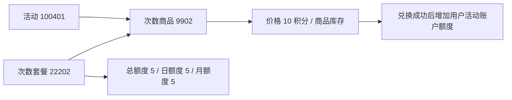

# 抽奖活动、次数套餐与次数商品

核查日期：2026-10-07。本地数据库已执行表名迁移；所有列的数据类型、业务编号与记录内容保持不变。

| 旧表名 | 当前表名 | 业务含义 |
| --- | --- | --- |
| raffle_activity | raffle_activity | 活动本身：名称、有效期、状态、抽奖策略 |
| raffle_activity_count | raffle_quota_plan | 每份套餐增加多少总、日、月抽奖额度；不是参与次数统计 |
| raffle_activity_sku | raffle_quota_product | 将活动与次数套餐组合为可发放/兑换的商品，配置积分价格及商品库存 |

活动本身不是商品；次数套餐不是会员价格规则；次数商品也不是抽中的奖品。
奖品位于 award / strategy_award，用户已经拥有的次数位于活动账户表。



日、月、总额度会同时约束抽奖；它们不是 5+5+5=15 次。商品发放时这些
数值会累加进账户，不能简单解释为整个活动永久固定的每日限购上限。

此次保持业务 ID 值不变，表名、Mapper SQL、初始化 SQL、迁移脚本及
中文注释同步修改。两张表中的 `activity_count_id` 已进一步改为 `quota_plan_id`，
Java/API 对应 `quotaPlanId`，`sku` 保留作为商品业务编号。历史迁移不能直接批量替换后重新执行。
迁移前检查所有消费者并备份；部署窗口内原子改名，更新应用后验证活动列表、
套餐读取、积分兑换和库存回写。不能只在数据库 GUI 改名字。

## 活动开启与权重启用的区别

当前活动 100401 状态为 open，有效期截至 2027-10-06，使用策略 10008。
活动开放、渠道上架、积分权重是不同维度。

积分权重规则需要：

1. 确定积分档位、每档奖品 ID，以及采用当前可用积分还是另设累计积分。
2. 明确匹配方式：目前代码是精确相等；门槛模式应切换到最高满足档位。
3. 修复权重结果直接跳过规则树的问题，确保次数锁和库存检查仍按设计执行。
4. 在 strategy.rule_models 启用 rule_weight，并在 strategy_rule 配置对应规则。
5. 更新策略缓存，重建进程内责任链，重新装配各权重奖池；只改数据库不保证生效。
6. 验证档位上下边界、积分兑换后变化、未解锁奖品和库存耗尽场景，再开放使用。

目前运营 HTTP 控制器提供权重查询与策略装配，但没有完整的权重编辑/发布入口。
本文没有启用权重或改变中奖概率；奖池和档位需要作为运营配置明确决定。

## 已实施的字段注释

三张表共 26 个字段均补充了业务注释。重点字段：

- `quota_plan_id`：抽奖次数套餐业务编号；商品表通过此字段关联 `raffle_quota_plan.quota_plan_id`。
- `total_count/day_count/month_count`：每份套餐增加的总/日/月参与抽奖额度，不是 AI 对话余额。
- `sku`：次数商品业务编号，不是中奖奖品编号。
- `product_amount`：每份次数商品消耗的积分，不是人民币金额。
- `stock_count/stock_count_surplus`：次数商品库存，单位为份；数据库剩余库存由 Redis 异步回写，可能延迟。
- `state`：活动开放状态，与渠道上下架独立。

迁移脚本：[20261007_rename_raffle_quota_tables.sql](dev-ops/mysql/migrations/20261007_rename_raffle_quota_tables.sql)。
独立测试库连续执行两次通过；本地迁移前后三张表逐行内容摘要一致。
Java 17 构建通过，新版本后端已部署启动；活动 100401 详情和积分兑换商品查询
均返回成功，套餐仍为 5/10/20 积分兑换 1/5/10 次抽奖。未执行实际兑换扣积分。
迁移本身不启用权重、不调整商品价格或发放额度。

字段迁移使用 [20261007_rename_quota_plan_id.sql](dev-ops/mysql/migrations/20261007_rename_quota_plan_id.sql)，在表名迁移之后执行。

回滚到最初版本应先停止新版本，再执行以下改名并部署旧版本；不要恢复整库覆盖后续业务数据：

```sql
ALTER TABLE raffle_quota_plan RENAME COLUMN quota_plan_id TO activity_count_id;
ALTER TABLE raffle_quota_plan RENAME INDEX uq_quota_plan_id TO uq_activity_count_id;
ALTER TABLE raffle_quota_product RENAME COLUMN quota_plan_id TO activity_count_id;
ALTER TABLE raffle_quota_product RENAME INDEX idx_activity_id_quota_plan_id TO idx_activity_id_activity_count_id;
RENAME TABLE raffle_quota_plan TO raffle_activity_count,
             raffle_quota_product TO raffle_activity_sku;
```

新部署使用更新后的初始化 SQL；已存在数据库只执行迁移，不重跑建库/种子脚本。

## 套餐编号字段与 Java 同步

两张表的 `quota_plan_id` 保留原编号值，索引也改为 `uq_quota_plan_id` 和
`idx_activity_id_quota_plan_id`。Mapper、DAO、PO、领域套餐实体及接口编号字段
同步改为 QuotaPlan / quotaPlanId 命名；嵌套次数内容 activityCount 保持兼容。
套餐及活动配置缓存使用新版本前缀，用户账户、余额和库存缓存不变。

验证：迁移测试库连续执行两次通过，本地迁移前后逐行摘要一致；Java 17
干净构建通过，ActivityQuotaIdempotencyTest 两项通过。新服务的商品查询和
运营活动详情均返回 quotaPlanId，原套餐 22201/22202/22203 保持不变。
用户前端 TypeScript 检查通过；运营端全量检查仍报 app.tsx 等文件的 Umi 类型错误，
本次修改的 activity.ts 未报错。

## raffle_activity_listing：渠道入口的活动上下架配置

这张表记录某个入口（channel + source）展示哪个活动，以及是否上架。
已从 raffle_activity_stage 改名为 raffle_activity_listing（活动上架配置）。
Java 上架配置 DTO、领域实体、服务、DAO、PO 和 Mapper 同步使用 RaffleActivityListing 命名。
现有 HTTP 路由和 JSON 字段保持兼容，因此前端调用地址不变。

- channel：渠道标识，例如 c01、test；这些是系统编码，不是活动名称。
- source：该渠道下的来源/入口标识，例如 s01、erp_demo。
- activity_id：此入口关联的活动编号。
- state：上架状态；active 已上架，inactive 已下架；历史默认 create 表示尚未上架。

当前 c01/s01 → 100401（已上架），test/erp_demo → 100501（已上架），
test/erp_new → 100502（已下架）。不同入口可各自上架活动。
raffle_activity.state 控制活动本身是否开放，本表控制入口是否展示/提供该活动；
实际查询还会要求活动开放且处于有效期内。

迁移脚本：`docs/dev-ops/mysql/migrations/20261007_rename_activity_listing.sql`。
迁移前已备份，测试库重复执行通过；本地迁移前后记录逐字节一致。
Java 17 干净构建和 6 项测试通过。实际 API 验证：列表 6 个活动，主入口
c01/s01 返回 100401，详情返回 8 个奖品和 3 个套餐；测试入口 test/erp_demo
下架返回空、上架返回 100501，验证后恢复原 active 状态。
回滚需停服后执行 `RENAME TABLE raffle_activity_listing TO raffle_activity_stage` 并部署旧版本。
